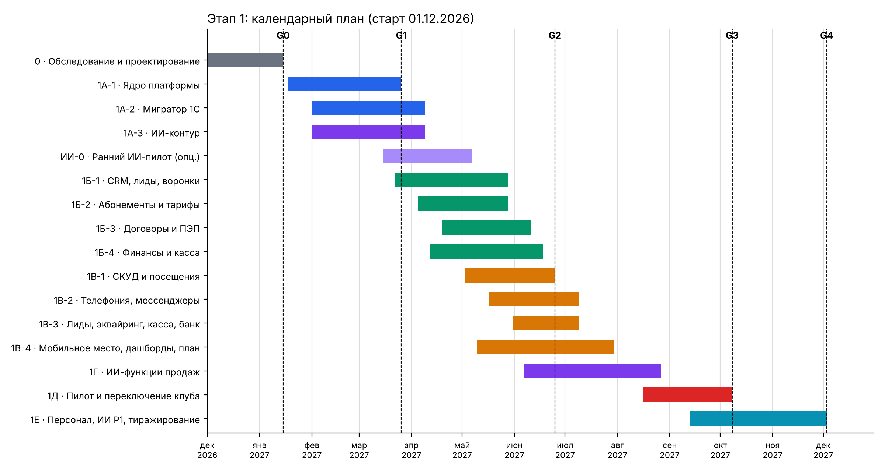

# Сведения о документе

| Параметр | Значение |
|---|---|
| Наименование | Техническое задание на платформу управления фитнес-клубом / сетью (рабочее название «Клубная ОС») |
| Версия | 2.0 (сводная), от 09.11.2026 |
| Статус | Проект для согласования с заказчиком и техническим архитектором |
| Заменяет | ТЗ v1.1 «Схема → разработка → доработки», ТЗ v1.2 «Архитектура и спецификация», ТЗ v1.3 «Умная миграция 5 отчётов 1С» |
| Включает | «СОФТ» (15 замечаний по 1С), «Дополнения 1 по наговорам» (п. 1–59), «Дополнения 2 по работе клуба» (п. 1–104), переписку рабочей группы 26.10–08.11.2026 |
| Владелец требований | Заказчик (собственник клуба); конкретное лицо назначается на установочном совещании |

**Как пользоваться документом.** Разделы 1–3 описывают цели, границы и роли. Раздел 4 содержит функциональные требования с идентификаторами (FR-…) и приоритетами. Разделы 5–8 описывают архитектуру, ИИ, интеграции и нефункциональные требования. Раздел 9 содержит этапы, сроки и трудоёмкость. Разделы 10–12 описывают приёмку, открытые вопросы и риски. В приложении А показано, где в ТЗ учтён каждый пункт исходных материалов.

**Приоритеты требований:**

- **P0** обязательно для пилота в собственном клубе (без этого 1С не отключить);
- **P1** обязательно для завершения Этапа 1 и продажи другим клубам;
- **P2** относится к Этапу 2; архитектура Этапа 1 должна позволять подключить эти функции без переделки;
- **P3** относится к Этапу 3 (стратегическое развитие экосистемы).

# 1. Общие сведения и цели

## 1.1. Назначение системы

Создаётся самостоятельная облачная платформа для управления фитнес-клубом и сетью фитнес-клубов. Она объединяет CRM и продажи, абонементы, договоры, финансы и кассу, контроль доступа, телефонию, аналитику и встроенный ИИ, который анализирует работу клуба и подсказывает решения.

Последовательность целей:

1. **Заменить 1С:Фитнес в собственном клубе заказчика.** После переноса данных 1С выводится из рабочего контура, постоянной синхронизации с 1С нет.
2. **Тиражировать продукт** и продавать его действующим фитнес-клубам и сетям по всей России (модель SaaS, подписка за клуб). Цена продукта обсуждается позже: сначала система делается для себя, но сразу с мультиклубной архитектурой.
3. **Развивать экосистему** (Этапы 2–3): модуль капитализации бизнеса, приложения тренера и клиента, медицинский контур. Монетизация идёт от клубов, а для тренеров и клиентов предусматриваются платные расширенные функции.

## 1.2. Бизнес-проблемы, которые решает система

Проблемы зафиксированы по опыту работы на 1С:Фитнес и в ходе обсуждений рабочей группы:

| № | Проблема сейчас | Что должна дать система |
|---|---|---|
| 1 | Монитор собственника и управляющего нельзя настроить: нельзя добавлять и убирать виджеты | Конструктор рабочих столов и дашбордов под каждую роль |
| 2 | При ручном вводе клиента не проставляются канал привлечения, источник и сделка в воронке | Автоматическая атрибуция, автоматический выбор воронки и первого этапа |
| 3 | Нет гибких выгрузок | Выгрузка любых списков и отчётов с параметрами в Excel, CSV и PDF |
| 4 | Нет нормального плана продаж по отделу, менеджеру и категориям, нет ежедневной сверки с кассой | Модуль плана продаж с расчётом, дефицитом, планом дня и ежедневной сверкой |
| 5 | Неудобная IP-телефония, звонки не анализируются | Интеграция с АТС, запись, транскрибация, смысловая запись в карточку |
| 6 | Договоры и документы оформляются долго и на бумаге | Шаблоны, сборка документа в 2–3 нажатия, подписание простой электронной подписью |
| 7 | Ограниченные способы входа в клуб | СКУД с картами, браслетами, QR-кодом и биометрией |
| 8 | Нет графиков, табеля и расчёта зарплаты от табеля и KPI | Модуль персонала |
| 9 | Менеджер может «бросить» карточку без задачи и без заполнения полей | Жёсткие правила воронки и обязательные поля |
| 10 | Нет конструктора отчётов | Конструктор отчётов из блоков |
| 11 | Каждая интеграция и перенос базы в 1С стоят отдельных денег, мессенджеры оплачиваются отдельно | Встроенные интеграции и бесплатная «умная миграция» как штатная функция продукта |
| 12 | Собственник не видит картину дня в реальном времени: доходы, расходы, эффективность | Онлайн-дашборд собственника с задержкой данных не более 5 минут |
| 13 | Менеджеры тратят время на бесперспективные дозвоны и ручное заполнение | ИИ-приоритизация, автозаполнение по звонкам, автокоммуникации с неприоритетными клиентами |

## 1.3. Ключевые принципы (обязательны для всех решений)

1. **Независимость от 1С.** 1С:Фитнес служит только источником разовой выгрузки истории. После переключения все операции и источники истины находятся в новой системе.
2. **ИИ предлагает, человек утверждает.** ИИ не меняет конфигурацию, суммы, сроки, скидки, цены, права и договорные шаблоны без явного подтверждения уполномоченного лица. Каждое предложение ИИ помечено как предложение, с автором, основанием и временем.
3. **Собственный ИИ.** ИИ разворачивается на собственной серверной инфраструктуре. Персональные данные не передаются во внешние сервисы без отдельного решения. На старте допускается подключаемая внешняя модель как сменный компонент, но только без передачи ПДн.
4. **Работа без ИИ.** Отказ ИИ не останавливает CRM, кассу, договоры, платежи и проходы. ИИ не находится в критическом пути проведения платежа.
5. **Гибкость под стандарт клуба.** Собственники и управляющие настраивают систему под свои стандарты без программиста: поля, этапы, тарифы, права, экраны, шаблоны, нормы, пороги и правила. Подсказки ИИ опираются на стандарт этого клуба.
6. **Mobile-first.** Отдел продаж и администраторы должны работать с рабочего телефона без ПК. Ожидаемый эффект: рост производительности на 15–20 %.
7. **Мультиклубность и изоляция.** Один продукт обслуживает много клубов и сетей. Ни один клуб не видит данные другого.
8. **Честные данные.** Отсутствие данных не подменяется нулём. У каждой цифры видны источник, период и время обновления. Проведённые финансовые операции не удаляются и не переписываются: исправления делаются только сторнирующими записями.
9. **Работа в России.** Данные хранятся и обрабатываются в РФ (152-ФЗ), связь идёт через российские каналы, сервисы открываются с обычного телефона без обходных средств.

## 1.4. Критерии успеха Этапа 1

| Критерий | Целевое значение (на утверждение) |
|---|---|
| Собственный клуб полностью работает в новой системе, 1С отключена | Да, по акту приёмки |
| Полнота миграции | 100 % идентификаторов сопоставлено; финансовые итоги по периодам совпадают с 1С; расхождения задокументированы |
| Доля звонков с автоматическим резюме в карточке | ≥ 90 % звонков с записью |
| Время менеджера на ручное заполнение карточек | снижение не менее чем на 50 % к замеру до внедрения |
| Время РОПа на анализ работы отдела | снижение с ~2 ч до ~15–30 мин в день (ориентир рынка) |
| Время до первого ответа на новый лид | медиана ≤ 5 мин в рабочее время |
| Все P0-сценарии менеджера доступны с телефона (390 px) | Да |
| Готовность к подключению второго клуба по чек-листу | ≤ 10 рабочих дней на клуб |

# 2. Границы проекта

## 2.1. Решение рабочей группы о составе Этапа 1

Из всего объёма идей рабочая группа выбрала для Этапа 1 **только ИИ, клубный софт и CRM** (решение от 07.11.2026). Остальные направления реализуются после того, как основной блок будет доведён до рабочего состояния. Этап 1 состоит из трёх смысловых частей:

1. построение правильного ядра;
2. минимальный функционал с возможностью добавлять дополнительные функции;
3. интеграции (СКУД, телефония, каналы привлечения лидов), нативный мобильный интерфейс, дашборды, разделение прав и собственный ИИ на своём сервере, который начинает обучаться.

## 2.2. Что входит в Этап 1

- мультиклубное ядро (сеть → клубы), роли и права, конфигуратор, журнал аудита;
- умная миграция из 1С:Фитнес (пять отчётов) и универсальный импорт из таблиц;
- CRM: клиентская база, сегменты, лиды и атрибуция, воронки, сделки, задачи, напоминания;
- абонементы, тарифы, заморозки, продления, рассрочки, лицевой счёт;
- договоры и документы, электронный архив, подписание ПЭП;
- финансы: касса и смены, платежи, эквайринг, рекуррентные списания, возвраты, расходы, сверка с банком, ДДС и план-факт;
- СКУД и учёт посещений клиентов и сотрудников;
- телефония, мессенджеры и каналы лидов;
- план продаж и KPI;
- ИИ-контур: транскрибация и резюме звонков, приоритизация (векторизация) базы, горячие списки, рекомендации на день, неделю и месяц, светофор, речевая аналитика, ИИ-помощник конфигурации с согласованием, ИИ-распознавание при миграции;
- дашборды и конструктор отчётов, выгрузки;
- мобильное рабочее место сотрудника;
- персонал: графики, табель, расчёт зарплаты по табелю и KPI (финальная часть Этапа 1);
- функции тиражирования: онбординг клуба, демо-клуб, поддержка, учёт договоров с клубами, ограничения для будущих тарифов.

## 2.3. Что не входит в Этап 1 (переносится на Этапы 2–3)

| Направление | Этап | Комментарий |
|---|---|---|
| Модуль капитализации бизнеса (оценка стоимости, «знак качества», отчёт для продажи бизнеса, кредитов и инвестиций) | 2 | Отдельная платная функция; данные для неё (доходы, расходы, KPI) собираются уже в Этапе 1 |
| Расширенный управленческий учёт (P&L, юнит-экономика, сигналы «расходы растут быстрее доходов») | 2 | В Этапе 1 есть ДДС, расходы и план-факт |
| ИИ-маркетолог: анализ конкурентов, сбор цен, разработка акций, ИИ-обзвон конкурентов | 2 | |
| Голосовой ИИ-робот автообзвона неприоритетных клиентов | 2 | В Этапе 1 есть автосообщения в мессенджерах и подготовка списков |
| ИИ-анализ встреч в переговорной (видео и аудио) | 2 | При наличии юридического основания и согласий |
| Приложение для клиента (запись на групповые занятия, оплата, история посещений, push-напоминания) | 2 | В Этапе 1 есть личный кабинет оплаты и мессенджеры |
| Приложение тренера (базовое: расписание, окна, клиенты) | 2 | |
| Техперсонал и клининг: задачи, фотофиксация уборки и ремонта | 2 | |
| Видеонаблюдение и периметр безопасности | 2 | |
| Рейтинги групповых программ и тренеров, подсказки, какие занятия «заходят» | 2 | |
| Тренерская ОС (голосовой ввод тренировок, программы, питание, модели «штат / аренда / процент / фриланс») | 3 | |
| Клиентский super app (клуб + тренер + медицина + не-фитнес функции) | 3 | |
| Медицинский контур (анализы, показатели, интеграция с клиниками) | 3 | Требует отдельного юридического заключения |
| Рейтинги клубов на картах, маркетплейс, обмен шаблонами между клубами за плату | 3 | |
| Самостоятельная генерация и выкладка программного кода ИИ | Не планируется | Запрещено архитектурными принципами |

# 3. Пользователи и роли

## 3.1. Перечень ролей

| Роль | Задачи в системе | Основной интерфейс |
|---|---|---|
| Собственник / директор сети | Цели, онлайн-дашборд «эффективность дня», доходы и расходы, утверждение изменений конфигурации и предложений ИИ, утверждение стандартов | Мобильное приложение + веб |
| Управляющий клубом | Операционные показатели, план-факт, риски, персонал, расходы в пределах лимита, контроль менеджеров | Мобильное приложение + веб |
| Руководитель отдела продаж (РОП) | Планы отдела и менеджеров, светофор, конверсия, речевая аналитика, рекомендации по отделу, распределение лидов | Мобильное приложение + веб |
| Менеджер отдела продаж | Лиды, звонки, встречи, сделки, договоры, оплаты, план дня, горячие списки | Мобильное приложение (основной), веб |
| Администратор ресепшн | Проходы, гости, продажа разовых визитов, касса и смена, выдача карт и браслетов, заморозки | Веб (планшет или ПК на ресепшн) + мобильное |
| Финансист / бухгалтер | Расходы, сверка с банком, возвраты, ДДС, ведомости, закрытие периода | Веб |
| Тренер (в Этапе 1 только базовый доступ) | Своё расписание и проведённые занятия для расчёта; отметка прихода | Мобильное |
| Технический персонал (Этап 2) | Задачи уборки и ремонта, фотофиксация | Мобильное |
| Администратор системы клуба | Настройка полей, этапов, тарифов, шаблонов, ролей, интеграций | Веб |
| Администратор платформы (наша команда) | Подключение клубов, договоры с клубами, поддержка, обновления, мониторинг | Веб (служебная консоль) |
| ИИ (сервисная учётная запись) | Чтение разрешённых данных, подготовка предложений, черновиков и рекомендаций | Без интерфейса; права минимальны |

## 3.2. Матрица прав (базовая, настраивается клубом)

Обозначения: **П** — полный доступ; **С** — только свой клуб или зона ответственности; **Л** — только свои записи; **Ч** — только чтение; **У** — утверждение; «—» — нет доступа.

| Объект / действие | Собственник | Управляющий | РОП | Менеджер | Ресепшн | Финансист | Админ системы |
|---|---|---|---|---|---|---|---|
| Клиенты и карточки | П | С | С | Л + общий пул | Ч + создание гостя | Ч | Ч |
| Просмотр действий других сотрудников и истории | П | С | С (отдел) | Ч (история клиента) | — | — | Ч |
| Сделки и воронка | П | С | С | Л | — | — | Ч |
| Договоры: создание | П | С | С | Л | С | — | — |
| Договоры: шаблоны | У | Ч | Ч | — | — | — | П (публикация после У) |
| Касса и смена | Ч | С | — | — | П | П | — |
| Возвраты | У | У (до лимита) | — | инициирует | инициирует | П (исполнение) | — |
| Расходы | У | С (до лимита) | — | — | — | П | — |
| План продаж | У | П | П (отдел) | Ч (свой) | — | Ч | — |
| Дашборд собственника | П | С | Ч (продажи) | — | — | Ч | — |
| Ведомость зарплаты | У | С | Ч (отдел) | Ч (своя строка с расшифровкой) | Ч (своя) | П | — |
| Записи звонков и транскрипты | П | С | С | Л | — | — | — |
| Предложения ИИ по конфигурации | У | У (свой клуб, некритичные) | предлагает | — | — | — | Ч |
| Роли и права | У | — | — | — | — | — | П (после У) |
| Выгрузки данных | П | С | С | — | — | С | — |

Требования к модели прав:

- права проверяются на уровне API и выборок данных, а не только скрытием пунктов меню;
- пользователь с ролью в клубе А не видит клуб Б, если доступ не выдан отдельно;
- исключения из прав выдаются через подтверждение и попадают в журнал;
- для привилегированных действий (утверждение ИИ-изменений, права, возвраты свыше лимита, выгрузка всей базы) обязательна двухфакторная аутентификация;
- каждый просмотр карточки клиента и каждое изменение фиксируются в журнале аудита.

# 4. Функциональные требования

## 4.1. Платформа, мультиклубность и тиражирование (FR-CORE)

| ID | Требование | Приор. |
|---|---|---|
| FR-CORE-01 | Иерархия «платформа → сеть (tenant) → клуб». Каждая бизнес-запись содержит tenant_id и club_id; данные разных сетей изолированы физически или логически с проверкой на уровне БД | P0 |
| FR-CORE-02 | Ни один клуб не видит данные другого ни в отчёте, ни в поиске, ни в выгрузке, ни в ответах ИИ | P0 |
| FR-CORE-03 | Клиент сети может посещать разные клубы сети по правилам тарифа. Один person_id на сеть | P0 |
| FR-CORE-04 | У каждого клуба свои данные, сотрудники, настройки, название, логотип и цвета (white-label в интерфейсе и документах) | P1 |
| FR-CORE-05 | Поддержка разных часовых поясов и регионов: время событий хранится в UTC, отображается в поясе клуба | P0 |
| FR-CORE-06 | Технические ограничения по числу сотрудников, клиентов, клубов и рабочих мест, чтобы ввести тарифы без переделки | P1 |
| FR-CORE-07 | Запуск нового клуба по чек-листу: создание сети, импорт, настройка, обучение, переключение. Целевой срок не более 10 рабочих дней | P1 |
| FR-CORE-08 | Учёт договоров с клубами-заказчиками: срок, число рабочих мест, ограничения, приостановка при неоплате без потери базы клуба | P1 |
| FR-CORE-09 | Полная выгрузка всех данных клуба при уходе в машиночитаемом формате (CSV или JSON + файлы документов) | P1 |
| FR-CORE-10 | Демонстрационный клуб с наполненными обезличенными данными для показа продукта | P1 |
| FR-CORE-11 | Возможность отдельного размещения (выделенный контур) для клуба, который не хочет общее облако | P2 |
| FR-CORE-12 | Обращения в поддержку из самой системы: тема, скриншот, история, сроки ответа, статус; журнал изменений системы понятным языком | P1 |
| FR-CORE-13 | Справочник внутри системы («как сделать») не дальше двух нажатий от любого экрана; обучение по ролям короткими заданиями | P1 |
| FR-CORE-14 | Режим проверки (песочница): проверочные действия не попадают ни в цифры, ни в деньги, ни в рабочие чаты, ни в отчёты | P0 |

## 4.2. Конфигуратор и стандарты клуба (FR-CFG)

| ID | Требование | Приор. |
|---|---|---|
| FR-CFG-01 | Без программиста настраиваются: поля карточек и их обязательность, этапы воронок, тарифы, права, состав экранов, шаблоны документов и сообщений | P0 |
| FR-CFG-02 | Настраивается всё, по чему оценивают людей и планируют продажи: причины отказа, стоп-листы «кого не обзванивать», обязательные поля, категории плана, нормы показателей, пороги цветов светофора, шаблоны сообщений, вопросы скрипта, тексты подсказок | P0 |
| FR-CFG-03 | Готовые наборы настроек под тип клуба: премиальный, массовый, студия (облегчённый формат, возможно один общий доступ), сеть. При подключении клуб выбирает готовый набор или начинает со своего | P1 |
| FR-CFG-04 | Поддержка моделей продаж: абонементы с фиксированным сроком, рекуррентная подписка (помесячное списание), пакеты занятий, разовые визиты; модели работы тренеров: штат (оклад + процент), аренда, процент от продаж | P0 |
| FR-CFG-05 | Стандарт продаж версионируется: кто утвердил, когда и что изменилось. Звонок и работа менеджера оцениваются по версии, действовавшей в момент события | P0 |
| FR-CFG-06 | При смене стандарта прошлое не переписывается: старые оценки и отчёты остаются как были | P0 |
| FR-CFG-07 | Конструктор правил «если → то» без программиста (триггер, условия, действия: задача, сообщение, смена этапа, уведомление руководителю) | P1 |
| FR-CFG-08 | Новое правило сначала проверяется на истории: система показывает, что было бы, если бы правило действовало раньше (сколько задач, сообщений, на каких клиентах) | P1 |
| FR-CFG-09 | Любую настройку можно вернуть к шаблону и посмотреть историю изменений; откат к предыдущей версии конфигурации | P0 |
| FR-CFG-10 | Обновления платформы приходят как предложение и не сбрасывают настройки клуба | P1 |
| FR-CFG-11 | Клубы по желанию делятся своими шаблонами (воронки, скрипты, правила) между собой | P3 |
| FR-CFG-12 | Изменения конфигурации публикуются как версия: черновик → проверка (тесты прав, данных, обратимости) → утверждение → публикация → откат | P0 |

## 4.3. Клиентская база и карточка клиента (FR-CRM)

| ID | Требование | Приор. |
|---|---|---|
| FR-CRM-01 | Единая клиентская база сети, один person_id на человека, несколько каналов связи (телефоны, e-mail, мессенджеры) | P0 |
| FR-CRM-02 | Автоматическое разделение базы на категории: потенциальные (лиды), новые, действующие члены клуба, на продление (оканчивается срок), бывшие члены клуба, отписавшиеся от подписки, гости; по источникам привлечения. Категории пересчитываются автоматически по событиям | P0 |
| FR-CRM-03 | Карточка клиента на одной странице: контакты, текущий абонемент и срок, остаток занятий, посещения, деньги и долг, документы, согласия, пометки, ответственный менеджер, история взаимодействий, ИИ-сводка и рекомендация | P0 |
| FR-CRM-04 | Первичный и последний источник привлечения, кампания, время заявки, время в ожидании ответа проставляются автоматически, а не руками | P0 |
| FR-CRM-05 | При ручном вводе клиента (гость, «с улицы») система обязательно требует источник из справочника, автоматически создаёт сделку в актуальной воронке и ставит первый этап; поиск дубля по телефону выполняется до сохранения | P0 |
| FR-CRM-06 | Антидубли: проверка при создании по составному правилу (телефон, e-mail, ФИО + дата рождения); не объединять только по совпадению имени. Склеивание дублей с сохранением истории обеих записей и указанием причины решения | P0 |
| FR-CRM-07 | Невозможно закрыть карточку клиента без заполнения обязательных полей | P0 |
| FR-CRM-08 | Невозможно закрыть карточку без постановки следующей задачи или закрытия сделки (продажа или отказ с причиной) | P0 |
| FR-CRM-09 | Приоритет клиента (ИИ-скоринг + ручная отметка) с выделением цветом в списках и карточке | P0 |
| FR-CRM-10 | Полная история взаимодействий: звонки, сообщения, встречи, визиты, платежи, документы, изменения, действия сотрудников. Видно, кто и что делал | P0 |
| FR-CRM-11 | Пометка «не может купить» с причиной (переезд, медицинские противопоказания, финансовые обстоятельства и т.д.) и сроком действия. Такие клиенты исключаются из обзвонов и горячих списков | P0 |
| FR-CRM-12 | Управление согласиями раздельно: обработка ПДн, запись разговоров, фото и видео, рекламные сообщения; отзыв согласия; обезличивание без разрушения финансовой истории | P0 |
| FR-CRM-13 | Журнал доступа к карточкам: кто смотрел и когда | P0 |
| FR-CRM-14 | Быстрый поиск по телефону, ФИО, номеру карты или договора; ответ не дольше 1 секунды | P0 |
| FR-CRM-15 | Массовые операции со списками: назначить ответственного, поставить задачу, отправить сообщение по шаблону, сформировать документы | P1 |

## 4.4. Лиды и каналы привлечения (FR-LEAD)

| ID | Требование | Приор. |
|---|---|---|
| FR-LEAD-01 | Автоматический приём заявок из всех подключённых источников: сайт и формы (включая Tilda и другие конструкторы), WhatsApp, Telegram, Макс, VK, Яндекс.Карты / Яндекс.Бизнес, входящие звонки, рекламные кабинеты, агрегаторы | P0 (сайт, звонки, мессенджеры), P1 (остальные) |
| FR-LEAD-02 | Каждая заявка автоматически получает теги: канал, кампания, UTM-метки, время поступления. Цель: исключить человеческий фактор в атрибуции | P0 |
| FR-LEAD-03 | Повторная заявка существующего клиента не создаёт нового клиента, а сохраняется как отдельное обращение | P0 |
| FR-LEAD-04 | Автоматическое назначение ответственного по правилам (очередь, нагрузка, специализация, клуб) и постановка первой задачи с дедлайном | P0 |
| FR-LEAD-05 | Учёт времени до первого ответа клиенту и эскалация руководителю при превышении нормы | P0 |
| FR-LEAD-06 | Горячий лид, поступивший в нерабочее время (поздно вечером), получает автоответ и ставится в приоритет на начало следующей смены; при настройке передаётся дежурному | P1 |
| FR-LEAD-07 | Расчёт конверсии, стоимости лида и ROI по каждому каналу ежедневно: бюджет канала (ввод или импорт) → лиды → встречи → продажи → выручка | P1 |
| FR-LEAD-08 | Конструктор ботов в мессенджерах для первичного сбора информации (имя, цель, удобное время) с передачей в CRM | P2 |
| FR-LEAD-09 | Сбор лидов из Telegram-каналов и других источников трафика по настроенным правилам | P2 |

## 4.5. Воронки продаж, сделки и задачи (FR-SALES)

| ID | Требование | Приор. |
|---|---|---|
| FR-SALES-01 | Несколько воронок (новые, продление, возобновление бывших, возврат отписавшихся, персональные тренировки и др.) с настраиваемыми этапами | P0 |
| FR-SALES-02 | Автоматический выбор воронки и первого этапа по категории клиента и источнику | P0 |
| FR-SALES-03 | Проверка корректности этапа сделки по истории карточки: нельзя перейти на этап «встреча проведена» без визита или отметки встречи, нельзя «продано» без оплаты. Попытку поставить «продано» без оплаты система помечает и сообщает РОПу | P0 |
| FR-SALES-04 | Статусная модель лида: новый → назначен → контакт → квалифицирован → выигран / проигран / дисквалифицирован; причина проигрыша обязательна | P0 |
| FR-SALES-05 | Статусная модель сделки: открыта → предложение → ожидает договор → выиграна / проиграна; «выиграна» только при выполнении утверждённого критерия продажи | P0 |
| FR-SALES-06 | Задачи с дедлайнами, типами (звонок, встреча, сообщение, документ), напоминаниями и отображением на главном экране менеджера | P0 |
| FR-SALES-07 | Напоминания менеджерам по заданным параметрам (окончание абонемента, день рождения, нет посещений N дней, неоплаченный платёж и т.п.) | P0 |
| FR-SALES-08 | Встроенная база знаний для начинающих менеджеров: подсказки по этапу, скрипты, ответы на возражения, напоминания в процессе работы; руководитель может отключить подсказки для конкретного сотрудника | P1 |
| FR-SALES-09 | Встречи: запись в календарь менеджера, подтверждение клиенту, отметка «пришёл / не пришёл», итоги встречи | P0 |
| FR-SALES-10 | Индивидуальные предложения клиенту рассчитываются из прейскуранта, действующих акций и истории клиента (ИИ предлагает, менеджер выбирает) | P1 |

## 4.6. Абонементы, тарифы и услуги (FR-MEM)

| ID | Требование | Приор. |
|---|---|---|
| FR-MEM-01 | Абонемент как отдельный объект: тариф, срок, остаток занятий, зоны и клубы доступа, ограничения по времени суток и дням недели | P0 |
| FR-MEM-02 | Тарифы и прейскурант с версиями цен: цена фиксируется в сделке и договоре снимком, изменение цены не меняет ранее заключённые договоры | P0 |
| FR-MEM-03 | Заморозка и разморозка: число дней, число заморозок в год, платная или бесплатная заморозка, автоматический сдвиг даты окончания | P0 |
| FR-MEM-04 | Продление со сдвигом от даты окончания текущего абонемента, а не от даты оплаты, чтобы клиент не терял дни | P0 |
| FR-MEM-05 | Переоформление абонемента на другого человека с документом и сохранением истории | P0 |
| FR-MEM-06 | Разовый визит и гостевой визит с ограничением количества на клиента и период | P0 |
| FR-MEM-07 | Рассрочка и частичная оплата, график платежей, остаток долга, лицевой счёт клиента | P0 |
| FR-MEM-08 | Рекуррентная подписка: периодичность, план списаний, повторные попытки при неудаче, уведомления, приостановка доступа при долге по правилам клуба, отписка и учёт отписавшихся | P0 |
| FR-MEM-09 | Пакеты персональных тренировок и услуг с учётом проведённых занятий | P0 |
| FR-MEM-10 | Акции, скидки, промокоды с ограничениями и согласованием скидок сверх лимита менеджера | P1 |
| FR-MEM-11 | Одновременное продление одного клиента двумя сотрудниками блокируется: вторая операция получает предупреждение, двойная продажа невозможна | P0 |
| FR-MEM-12 | Расписание групповых и персональных занятий, запись клиента администратором или менеджером, отметка проведения (основа для расчёта с тренерами) | P1 |

## 4.7. Договоры и документы (FR-DOC)

| ID | Требование | Приор. |
|---|---|---|
| FR-DOC-01 | Библиотека шаблонов с версиями: договор, согласия, анкета, акт, заявление на возврат, заявление на заморозку, переоформление, допсоглашение | P0 |
| FR-DOC-02 | Документ собирается из карточки клиента за 2–3 нажатия; данные подставляются автоматически | P0 |
| FR-DOC-03 | Статусы документа: черновик → на проверке → готов к подписанию → подписывается → подписан / отклонён / истёк / аннулирован | P0 |
| FR-DOC-04 | Подписание простой электронной подписью (код из SMS или мессенджера, подтверждение в личном кабинете) с фиксацией доказательств: идентификация подписанта, время, IP или устройство, хэш файла. Статус «подписан» только при подтверждении провайдера; PDF без подписи не равен подписанному договору | P0 |
| FR-DOC-05 | После подписания документ неизменяем; изменения оформляются новой версией или допсоглашением | P0 |
| FR-DOC-06 | Выдача копии документа клиенту по запросу (в мессенджер, e-mail, личный кабинет) | P0 |
| FR-DOC-07 | Массовое формирование документов по списку клиентов | P1 |
| FR-DOC-08 | Электронный архив: шифрование, разграничение доступа, контрольные суммы, срок хранения по политике | P0 |
| FR-DOC-09 | ИИ может собрать проект документа только из разрешённых блоков и подсветить расхождения с шаблоном. Новые условия публикуются только после утверждения юристом или уполномоченным лицом | P1 |
| FR-DOC-10 | Доступ клиента в клуб включается только по утверждённым правилам после нужных событий (подписан договор и (или) поступила оплата) | P0 |

## 4.8. Финансы, касса и платежи (FR-FIN)

| ID | Требование | Приор. |
|---|---|---|
| FR-FIN-01 | Финансовый журнал: начисление (обязательство клиента) отделено от поступления денег. Проведённые записи не удаляются, исправления делаются сторно | P0 |
| FR-FIN-02 | Кассовая смена: открытие и закрытие, остаток, внесение, изъятие, инкассация, расхождение по смене с объяснением | P0 |
| FR-FIN-03 | Фискализация по 54-ФЗ: чек прихода, чек возврата, чек коррекции через онлайн-кассу; при сбое печати чек ставится в очередь, продажа помечается и формируется задача | P0 |
| FR-FIN-04 | Онлайн-оплата через ссылку и личный кабинет, эквайринг (карты, СБП), рекуррентные списания по токену. Факт оплаты определяется только по подтверждённому событию провайдера, не по переходу в браузере | P0 |
| FR-FIN-05 | Повторное уведомление провайдера не создаёт двойного поступления (идемпотентность) | P0 |
| FR-FIN-06 | Возврат: заявление → причина → расчёт остатка (в том числе после заморозки и переноса срока) → согласование по лимитам → обратная операция у провайдера → чек возврата. Исходный платёж не удаляется; возврат больше допустимого остатка невозможен | P0 |
| FR-FIN-07 | Сверка с банком и эквайрингом: поступление, комиссия, дата зачисления. Несверенный платёж помечается статусом «не сверено» и создаёт задачу | P0 |
| FR-FIN-08 | Ежедневная сверка факта продаж с кассой и эквайрингом с отчётом расхождений | P0 |
| FR-FIN-09 | Расходы клуба: статья, клуб, контрагент, дата, документ, утверждение по сумме (лимиты по ролям), распределение общих расходов сети по клубам | P0 |
| FR-FIN-10 | Долги клиентов: кто, сколько, сколько дней, автоматические напоминания | P0 |
| FR-FIN-11 | Отчёт по деньгам: приход, расход, движение денежных средств (ДДС), продажи, начисления, план и факт; метрики «выручка», «поступления», «начисления» явно разделены и описаны в словаре KPI | P0 |
| FR-FIN-12 | Расчёт экономии на эквайринге от рекуррентных платежей и сравнение провайдеров по комиссии | P2 |
| FR-FIN-13 | Управленческий P&L, юнит-экономика клуба, сигналы о росте расходов быстрее доходов | P2 |
| FR-FIN-14 | Бухгалтерский и налоговый учёт не входят в систему. Предусмотрена выгрузка данных для бухгалтерии (в том числе в формате для 1С:Бухгалтерии) | P1 |

## 4.9. Контроль доступа и посещения (FR-ACS)

| ID | Требование | Приор. |
|---|---|---|
| FR-ACS-01 | Интеграция со СКУД и турникетами: решение о проходе по правилам абонемента (активен, не заморожен, нет долга, тот клуб, то время) | P0 |
| FR-ACS-02 | Идентификаторы: карта, браслет, QR-код в мобильном приложении или мессенджере; биометрия (отпечаток или лицо) при наличии оборудования и отдельного согласия | P0 (карта, браслет, QR), P1 (биометрия) |
| FR-ACS-03 | Работа при пропавшем интернете: правила хранятся на локальном контроллере или шлюзе, проходы накапливаются и потом выгружаются без дублей. Сценарий проверки: нет интернета 2 часа в час пик | P0 |
| FR-ACS-04 | Ручной проход только с указанием причины и сотрудника, который пустил; всё видно в отчёте | P0 |
| FR-ACS-05 | Понятная причина отказа в проходе человеческим языком на экране ресепшн: закончился, заморожен, долг, не тот клуб, не то время | P0 |
| FR-ACS-06 | Замена и перевыпуск карты или браслета без создания второго клиента | P0 |
| FR-ACS-07 | Сырое событие прохода хранится отдельно от расчётного посещения. Повторы не увеличивают число посещений; время в клубе рассчитывается только при наличии события выхода | P0 |
| FR-ACS-08 | Учёт посещений сотрудников (менеджеры, администраторы, тренеры, техперсонал): приход, уход, обед — основа табеля | P1 |
| FR-ACS-09 | Посещение клиентом другого клуба сети по правилам тарифа | P0 |
| FR-ACS-10 | Реестр совместимого оборудования с моделями и протоколами | P1 |
| FR-ACS-11 | Метрики посещаемости: количество тренировок, время в клубе, частота; триггер «давно не был» для удержания | P0 |

## 4.10. Телефония и коммуникации (FR-TEL, FR-MSG)

| ID | Требование | Приор. |
|---|---|---|
| FR-TEL-01 | Интеграция с несколькими облачными АТС и IP-телефонией: входящие с карточкой клиента на экране, исходящие в один клик из карточки (в том числе с мобильного), запись разговоров | P0 |
| FR-TEL-02 | Каждый звонок автоматически привязывается к клиенту и сделке; неизвестный номер создаёт лид | P0 |
| FR-TEL-03 | Пропущенный звонок создаёт задачу перезвонить с дедлайном | P0 |
| FR-TEL-04 | Учёт «эфирного времени»: считаются только состоявшиеся диалоги, без наборов и гудков | P0 |
| FR-TEL-05 | Хранение записей с правами доступа и сроком хранения; без согласия, где оно требуется, используются только допустимые метаданные | P0 |
| FR-MSG-01 | Переписка с клиентом в WhatsApp, Telegram, Макс и SMS из карточки клиента в едином окне | P0 (Telegram, SMS, WhatsApp через провайдера), P1 (Макс) |
| FR-MSG-02 | Шаблоны сообщений и триггерные рассылки (окончание абонемента, долг, давно не был, день рождения, запись на занятие) с учётом согласий, лимитов частоты и стоп-листов | P0 |
| FR-MSG-03 | Автокоммуникации с неприоритетными клиентами через мессенджеры (ИИ формирует текст по шаблону, клиент отвечает, горячие ответы передаются менеджеру) | P1 |
| FR-MSG-04 | Push-уведомления в клиентском приложении | P2 |

## 4.11. План продаж и KPI (FR-PLAN)

| ID | Требование | Приор. |
|---|---|---|
| FR-PLAN-01 | План продаж задаётся на месяц по отделу (общий) и по каждому менеджеру (личный) | P0 |
| FR-PLAN-02 | Разбивка плана по категориям: новые клиенты, продления действующих, возобновление бывших членов клуба, рекуррентные подписки (новые и возврат отписавшихся), персональные тренировки и др. Категории настраиваются | P0 |
| FR-PLAN-03 | План выставляется в деньгах и в клиентах. Количество клиентов рассчитывается через плановую средневзвешенную стоимость абонемента или стоимость месяца подписки | P0 |
| FR-PLAN-04 | Расчётный (рекомендуемый) план: на основе оканчивающихся в периоде контрактов, индивидуальной истории каждого клиента, ожидаемого чека, вероятности продления, выполнения стандартов продаж, динамики, сезонности, конкурентной среды и расходной части. В расчёте указываются риски, возможности и рекомендованные действия. Итоговый план утверждает руководитель | P1 |
| FR-PLAN-05 | Любая цифра плана раскрывается до конкретных клиентов (кто входит в план продлений и с какой вероятностью) | P1 |
| FR-PLAN-06 | Менеджер видит на главном экране: личный план на месяц и на день, факт, процент выполнения на текущий момент, дефицит по каждой категории. РОП видит то же по отделу и по каждому менеджеру | P0 |
| FR-PLAN-07 | Расчёт дефицита плана по категориям и прогноз выполнения к концу месяца. Если в конце месяца не хватает до плана, это видно заранее | P0 |
| FR-PLAN-08 | KPI сотрудников с ежедневным отслеживанием: звонки, эфирное время, назначенные и проведённые встречи, продажи, отказы, задачи, время до первого ответа. Нормы задаются клубом | P0 |
| FR-PLAN-09 | Выгрузка факта продаж по заданным параметрам ежедневно | P0 |

## 4.12. Встроенный ИИ: функции для пользователей (FR-AI)

| ID | Требование | Приор. |
|---|---|---|
| FR-AI-01 | **Транскрибация звонков** из подключённых АТС (русский язык; другие языки по настройке) | P0 |
| FR-AI-02 | **Смысловое резюме звонка в карточку**: суть, потребность, возражения, договорённости, следующий шаг. Черновик подтверждает или исправляет менеджер; задачи создаются автоматически. Если запись не распозналась, менеджер получает уведомление и короткую форму ручного итога | P0 |
| FR-AI-03 | **Контроль заполнения**: если разговор состоялся, а менеджер карточку не заполнил, система дозаполняет черновик из резюме и сообщает РОПу | P0 |
| FR-AI-04 | **Векторизация и скоринг базы**: постоянный пересчёт приоритета каждого клиента (вероятность покупки, продления, возврата, риск оттока) по истории взаимодействий, посещений, платежей и звонков. Хранение векторных представлений, семантический поиск по базе | P0 |
| FR-AI-05 | **Маршрутизация**: самые горячие и перспективные клиенты передаются менеджерам; неприоритетные — в автокоммуникации; бесперспективные и «не может купить» исключаются из обзвона | P1 |
| FR-AI-06 | **Горячий список под задачу**: по запросу менеджер за секунды получает свой персональный список клиентов, которые не говорили «нет», планировали покупку, но не купили, без тех, кто не может купить, с рассчитанным индивидуальным предложением по каждому | P0 |
| FR-AI-07 | **План дня менеджера**: что сделать сегодня для выполнения плана дня по каждой категории, кому звонить в первую очередь, как распределить рабочий день | P0 |
| FR-AI-08 | **Еженедельный обзор менеджера**: эффективность, сильные и слабые места, в какой категории клиентов проседает и почему, где сильная позиция, рекомендации на неделю | P1 |
| FR-AI-09 | **Месячная сводка менеджера**: что удалось, что не удалось, что сделать для роста эффективности | P1 |
| FR-AI-10 | **Рекомендации для РОПа** по отделу и каждому менеджеру на день, неделю и месяц, с обратной связью: выполнялась ли рекомендация и как изменились показатели. Невыполненная рекомендация видна | P1 |
| FR-AI-11 | **Светофор менеджеров**: зона риска, норма, лучшие. Пороги задаются клубом | P0 |
| FR-AI-12 | **Речевая аналитика**: оценка звонков по чек-листу стандарта клуба (версия стандарта на момент звонка), выявление лучших практик, бенчмаркинг лучших звонков, предложения по обновлению скриптов. Цепочка: транскрибация → речевая аналитика → бенчмаркинг → обновление скриптов (после утверждения РОПом) | P1 |
| FR-AI-13 | **Помощник собственника и управляющего**: вопросы на естественном языке по данным клуба («почему упали продления в октябре?») с указанием источника, периода и уверенности | P1 |
| FR-AI-14 | **ИИ-помощник конфигурации**: по цели руководителя («рост продлений») анализирует данные и предлагает изменения (поля, правила, сегменты, задачи, дашборды) в виде diff с ожидаемым эффектом и рисками. Внедряется только утверждённая версия, после тестов, с мониторингом эффекта и откатом | P1 |
| FR-AI-15 | **ИИ-распознавание при миграции**: определение типа отчёта, колонок и форматов, предложение карты полей с уровнем уверенности | P0 |
| FR-AI-16 | **Честность ИИ**: при недостатке данных ответ «данных недостаточно», без выдумывания; каждая рекомендация показывает использованные данные, период и уверенность; прогноз не подаётся как факт | P0 |
| FR-AI-17 | **Анализ рабочего времени сотрудников**: принятые и отработанные заявки, выполненные и поставленные задачи, продажи, отказы, эфирное время, сравнение сотрудников на одинаковых должностях | P1 |
| FR-AI-18 | Голосовой ИИ-робот автообзвона неприоритетных клиентов с передачей горячих менеджеру; холодный клиент, до которого дозвонился робот, обрабатывается по отдельному сценарию | P2 |
| FR-AI-19 | ИИ-анализ встреч в переговорной (аудио, затем видео) с записью сути и договорённостей в CRM; отказ клиента от записи не ломает учёт встречи | P2 |
| FR-AI-20 | ИИ-маркетолог: анализ конкурентов (цены с сайтов, расписание, акции), разработка акций, сводный анализ конкурентной борьбы | P2 |

## 4.13. Дашборды, отчёты и выгрузки (FR-DASH)

| ID | Требование | Приор. |
|---|---|---|
| FR-DASH-01 | Конструктор рабочего стола: каждый пользователь (в рамках прав) добавляет, убирает и переставляет виджеты; руководитель задаёт стандартные рабочие столы для ролей | P0 |
| FR-DASH-02 | Дашборд собственника «эффективность дня» онлайн: продажи, поступления, расходы, план-факт, посещаемость, лиды, конверсия, потенциал базы, отклонения. Задержка данных не более 5 минут; время последнего обновления показано на экране | P0 |
| FR-DASH-03 | Дашборд управляющего: операционные показатели, план-факт, риски, персонал | P0 |
| FR-DASH-04 | Дашборд РОПа: конверсия «звонок → назначенная встреча → состоявшаяся встреча → покупка» по каждому рекламному каналу, менеджеру, в среднем по отделу; светофор; выполнение плана | P0 |
| FR-DASH-05 | Монитор отдела продаж (ТВ-экран в отделе): план, факт, рейтинг, сроки | P1 |
| FR-DASH-06 | Конструктор отчётов: выбор блоков, показателей, разрезов, фильтров и периода, сохранение и расписание отправки | P1 |
| FR-DASH-07 | Выгрузка любого списка и отчёта с заданными параметрами в XLSX, CSV и PDF; выгрузки журналируются | P0 |
| FR-DASH-08 | Словарь метрик: у каждого показателя есть определение, формула, источник и задержка обновления. Отсутствие данных не отображается как ноль | P0 |
| FR-DASH-09 | Потенциал базы и маркетинга: сколько клиентов в каждой категории можно конвертировать и в какие деньги | P1 |

## 4.14. Персонал, табель и зарплата (FR-STAFF)

| ID | Требование | Приор. |
|---|---|---|
| FR-STAFF-01 | Графики работы сотрудников (смены, сменные графики, замены) | P1 |
| FR-STAFF-02 | Табель учёта рабочего времени с автоматической фиксацией прихода, ухода и обеда через СКУД или специальный считыватель; отметки вне клуба по геолокации — по отдельному решению | P1 |
| FR-STAFF-03 | Учёт переработок, опозданий, недоработок; отпуск, больничный, отгул с влиянием на график и табель | P1 |
| FR-STAFF-04 | Расчёт зарплаты по табелю и KPI (для всех, кроме тренеров); расчёт с тренерами по факту проведённых занятий и по их модели (штат, процент, аренда) | P1 |
| FR-STAFF-05 | Расчётная ведомость с расшифровкой каждой строки, которую видит сам сотрудник; утверждение ведомости и запрет изменения после утверждения (только корректировкой в следующем периоде) | P1 |
| FR-STAFF-06 | Показатели нагрузки от нормы: сколько должен сделать и сколько сделал | P1 |
| FR-STAFF-07 | Выгрузка начислений для бухгалтерии; кадровый учёт и налоги вне системы | P1 |

## 4.15. Миграция из 1С:Фитнес и других систем (FR-MIG)

Импорт из конкурирующей системы является штатным сценарием продукта, а не разовой услугой. На пилоте поддерживаются ровно пять фактических отчётов выгрузки 1С:Фитнес; после изучения образцов их версии формализуются, а адаптеры расширяются на другие системы.

**Процесс миграции:**

| Шаг | Исполнитель | Действие и результат |
|---|---|---|
| 01 | Собственник или администратор | Загружает комплект из пяти файлов, выбирает клуб и подтверждает полномочия на перенос |
| 02 | Контур загрузки | Проверяет формат, размер, вирусы, кодировку, целостность; сохраняет исходники неизменными с хэшами |
| 03 | ИИ + реестр шаблонов | Определяет тип каждого отчёта, заголовки, единицы, даты, кандидатов полей; возвращает уверенность и объяснение |
| 04 | Специалист по внедрению | Утверждает карту полей, правила связей и обработку неоднозначных строк. Низкая уверенность блокирует автоматический импорт строки |
| 05 | ETL / staging | Загружает в промежуточные таблицы, нормализует, находит дубли, связывает клиентов, договоры, оплаты, посещения |
| 06 | Модуль сверки | Сравнивает количество, суммы и периоды, выявляет пропущенные связи и аномалии, формирует отчёт расхождений |
| 07 | Уполномоченный сотрудник | Утверждает итог; система выполняет идемпотентную загрузку с журналом происхождения |
| 08 | Собственник и команда | Выборочная приёмка, фиксация даты переключения, 1С выводится из рабочего контура |

| ID | Требование | Приор. |
|---|---|---|
| MIG-01 | Загрузка комплекта из пяти файлов в один пакет с проверкой полноты: при отсутствии файла импорт останавливается с объяснением, какой отчёт нужен | P0 |
| MIG-02 | Распознавание типов отчётов и показ карты полей с уровнем уверенности до импорта | P0 |
| MIG-03 | Идемпотентность, повторная загрузка, откат до принятия: двойной запуск не создаёт дубли и не удваивает деньги | P0 |
| MIG-04 | Контрольная сверка количества клиентов, договоров, операций, посещений: исходное, загружено, исключено, конфликтное | P0 |
| MIG-05 | Сверка финансов без округлений и без исправлений со стороны ИИ: суммы по периодам и видам операций совпадают с источником | P0 |
| MIG-06 | Разрешение дублей и конфликтов с ручным подтверждением; конфликт сохраняется как задача и не уничтожает исходную запись | P0 |
| MIG-07 | Работа CRM без 1С после переключения: продажа → договор → платёж → посещение → дашборд | P0 |
| MIG-08 | Библиотека версий шаблонов: повторный импорт того же формата у другого клуба идёт по уже проверенной карте | P1 |
| MIG-09 | Переносятся справочники: тарифы, направления, залы, тренеры, сотрудники, статьи расходов | P0 |
| MIG-10 | Переносится расписание и персональные занятия с честной отметкой о неполном переносе | P1 |
| MIG-11 | Переносятся кассовые данные в объёме, нужном для сверки и первого возврата денег | P0 |
| MIG-12 | Переносится история звонков и переписки из телефонии и мессенджеров (при наличии доступа) | P1 |
| MIG-13 | Отчёт о полноте: что перенесено, чего не было в источнике, что требует решения человека | P0 |
| MIG-14 | Импорт из других систем (Fitbase, Mobifitness и др.) через адаптеры и универсальный импорт из таблицы по шаблону | P1 |
| MIG-15 | У каждой импортированной записи хранятся club_id, source_system, source_report_type, source_file_id, source_row_id, external_id, imported_at, mapping_version, import_batch_id, checksum | P0 |

**Правила переноса по объектам:**

| Объект | Обязательные поля и связи | Особый контроль |
|---|---|---|
| Клиент | ФИО, контакты, внешний ID, клуб, даты, доступные согласия | Дедупликация по составному правилу, не только по имени |
| Договор / абонемент | Номер, клиент, тип, даты, статус, сумма, ограничения, история изменений | Не придумывать недостающие статусы и суммы, сохранять оригинальные реквизиты |
| Платёж / возврат | ID операции, клиент, договор, сумма, дата, способ, тип, документ | Балансовая сверка, ИИ не меняет суммы |
| Посещение / услуга | Клиент, дата и время, клуб, вид услуги | Без события выхода длительность не вычисляется |
| Коммуникации | Заявки, действия, заметки, звонки (если есть в выгрузке) | Неполнота выгрузки отмечается явно |

**Ограничение.** Названия, состав и полнота пяти отчётов пока неизвестны (ожидается документация 1С от рабочей группы). До получения реальных образцов обещать 100 % перенос всей истории нельзя. Если отчёты не содержат части данных, нужен дополнительный экспорт либо явная фиксация исключений.

## 4.16. Мобильное рабочее место (FR-MOB)

| ID | Требование | Приор. |
|---|---|---|
| FR-MOB-01 | Все P0-сценарии менеджера и РОПа доступны с телефона шириной 390 px без горизонтальной прокрутки: главный экран с планом дня, список задач, горячий список, карточка, звонок в один клик, переписка, договор и ссылка на оплату, встреча | P0 |
| FR-MOB-02 | Мобильное приложение для iOS и Android (нативное или кроссплатформенное, решение на этапе проектирования) с push-уведомлениями о задачах, лидах и напоминаниях | P1 (на пилоте допускается адаптивное веб-приложение / PWA) |
| FR-MOB-03 | Мобильный дашборд собственника и управляющего | P0 |
| FR-MOB-04 | Работа при нестабильной связи: кэш последних данных, очередь действий, явный индикатор офлайн | P1 |
| FR-MOB-05 | Интеграция с рабочим телефоном: звонок через АТС клуба, запись звонков с мобильного (через мобильную АТС оператора или SIP-клиент) | P1 |
| FR-MOB-06 | Вход по биометрии устройства, удалённое завершение сессии при увольнении или утере телефона | P1 |

# 5. Архитектура и сквозные процессы

## 5.1. Общая схема

| Уровень | Компоненты |
|---|---|
| Пользователи | Собственник, управляющий, РОП, менеджер, ресепшн, финансист, администратор системы, администратор платформы |
| Интерфейсы | Мобильное приложение (iOS, Android), адаптивный веб, экран ресепшн, ТВ-монитор отдела продаж, служебная консоль платформы |
| Доступ | Единый вход (SSO), роли и клубы, 2FA, API-шлюз с проверкой прав |
| Бизнес-домены | identity, crm, sales, memberships, contracts, billing/ledger, attendance, staff, integrations, analytics, ai, config, migration |
| Общие сервисы | Шина событий (transactional outbox), фоновые задачи, журнал аудита, конфигурация и версии, уведомления, файлы, поиск |
| Данные | Транзакционная реляционная БД; объектное хранилище (договоры, записи звонков, исходники импорта); аналитическое хранилище; векторный индекс с разграничением по tenant |
| ИИ-контур | Отдельный сервер: распознавание речи, языковая модель, оркестратор, база знаний, оценка качества, реестр предложений |
| Внешние системы | СКУД, АТС, мессенджеры, формы и рекламные каналы, эквайринг, онлайн-кассы и ОФД, провайдер ЭП, банки; разовый импорт из 1С |

## 5.2. Рекомендуемые технические решения (утверждает архитектор на этапе 0)

| Область | Рекомендация | Обоснование |
|---|---|---|
| Стиль архитектуры | Модульный монолит с чёткими границами доменов и API; ИИ-инференс и интеграционные обработчики вынесены в отдельные сервисы | Быстрее для пилота, проще эксплуатация; разделение на сервисы позже по факту нагрузки |
| Основная БД | PostgreSQL (с расширением pgvector для векторного поиска на старте) | Транзакционность финансов, зрелость, доступность в российских облаках |
| Очереди и события | Transactional outbox + брокер сообщений (RabbitMQ или Kafka) | Гарантированная доставка, повторы, идемпотентность, DLQ |
| Аналитика | Отдельная аналитическая БД (например, ClickHouse) или витрины в PostgreSQL на старте | Онлайн-дашборды без нагрузки на рабочую БД |
| Файлы | S3-совместимое хранилище в российском облаке с шифрованием | Договоры, записи звонков, исходники импорта |
| Мобильное приложение | Кроссплатформенный фреймворк (Flutter или React Native) с единым дизайном для iOS и Android; на пилоте допустимо PWA | Один код на две платформы, «нативный» UX, push-уведомления |
| Размещение | Российское облако с аттестацией по 152-ФЗ (уровень защищённости ПДн по модели угроз), отдельный GPU-сервер для ИИ | Требование хранения ПДн в РФ |
| Распознавание речи | Локальная модель ASR с поддержкой русского языка, развёрнутая на своём GPU | ПДн и записи не уходят наружу |
| Языковая модель | Открытая LLM, развёрнутая на своём сервере (класс 7–70 млрд параметров, выбор по результатам оценки на эталонных кейсах); внешняя модель только как сменный компонент без ПДн | Принцип «свой ИИ» |
| Наблюдаемость | Централизованные логи, метрики, трассировка, алерты | Контроль интеграций и SLA |
| Инфраструктура как код | Описание сред (dev, test, stage, prod) в репозитории, CI/CD с автотестами | Воспроизводимость и передача заказчику |

## 5.3. Минимальная модель данных

| Сущность | Ключевые поля | Правила |
|---|---|---|
| Tenant / Club | tenant_id, club_id, timezone, status, тариф платформы | Сеть → клубы; изоляция данных |
| User / Role / Assignment | user_id, role_id, club_scope, active | RBAC + ограничения по клубам |
| Person / Contact / Consent | person_id, ФИО, дата рождения, каналы связи, согласия | Один person_id; слияние только с аудитом |
| Lead / Attribution | lead_id, person_id, source, campaign, utm, created_at, first_response_at | Первичный и последний источник |
| Opportunity / Task / Meeting | opportunity_id, pipeline, stage, owner_id, next_action; task_id; meeting_id | История статусов обязательна |
| Product / PriceVersion / Promotion | product_id, price_version_id, amount, validity | Цена фиксируется снимком |
| Membership (абонемент / подписка) | membership_id, product, start, end, остаток, заморозки, зоны, ограничения | Изменения только операциями (заморозка, продление, переоформление) |
| Contract / DocumentVersion / Signature | contract_id, template_version, status, signer, file_hash, доказательства | Подписанное неизменяемо |
| Charge / Payment / Refund | charge_id, payment_id, provider_event_id, amount, status | Начисление отдельно от денег; идемпотентность |
| LedgerEntry / Expense / CashShift | entry_id, type, amount, date, account, club; shift_id | Только сторно, без удаления |
| AccessEvent / Visit / Device | external_event_id, device_id, occurred_at, decision, reason | Сырое событие отдельно от посещения |
| Call / Message / Transcript / Summary | external_call_id, person_id, recording_ref, transcript_ref, summary, оценка | Права и сроки хранения |
| SalesPlan / PlanLine / KPI | period, club, owner, category, money, clients, avg_price | Версии плана; утверждение |
| Schedule / Timesheet / Payroll | смена, факт, отклонения, ведомость, статус утверждения | Утверждённая ведомость неизменяема |
| AIProposal / Approval / ConfigVersion / Release | proposal_id, diff, diff_hash, risk, approval_id, release_id | Утверждается конкретный diff |
| AIRecommendation / Feedback | recommendation_id, адресат, основание, уверенность, статус выполнения, эффект | Для обратной связи по рекомендациям |
| ImportBatch / ExternalIDMap | batch_id, source_system, external_id, local_id, mapping_version | Прослеживаемость и воспроизводимость |

**Обязательные инварианты:**

1. Проведённые финансовые операции не изменяются напрямую, только корректирующими записями с полным следом аудита.
2. События интеграций могут приходить повторно и не по порядку; обработка идемпотентна.
3. Статус «подписан» только при подтверждённых доказательствах подписания.
4. Изменение цены не меняет условия ранее заключённых договоров.
5. Слияние дублей сохраняет ссылки на исходные записи и причины; удаление или обезличивание клиента не разрушает финансовую и договорную историю.
6. Пользователь клуба А не видит клуб Б без отдельного доступа.

## 5.4. Владельцы данных после запуска

| Объект | Источник истины | Кто меняет | Гарантия |
|---|---|---|---|
| Клиент и принадлежность к клубу | CRM | Сотрудник по правам, импорт | Один person_id, история изменений |
| Договор | Сервис договоров | Уполномоченный сотрудник, ЭП | Подписанная версия неизменяема |
| Начисление | Финансовый журнал | Тарифный и договорный процесс | Проведённое не переписывается |
| Факт платежа | Провайдер → финансы | Подтверждённое событие провайдера | Идемпотентность и сверка |
| Вход и выход | СКУД → посещения | Устройство или доверенная интеграция | Сырое событие хранится отдельно |
| Конфигурация | Сервис конфигурации | Публикация после утверждения | Версии, откат, аудит |
| Вывод ИИ | Реестр предложений ИИ | ИИ создаёт только предложение | Нет прямой записи в рабочую конфигурацию |

## 5.5. Сквозные сценарии

| Код | Сценарий | Цепочка | Контроль ошибок |
|---|---|---|---|
| F01 | Новый лид | Источник → API или webhook → проверка подписи и дублей → клиент и лид → назначение → задача → событие LeadCreated → дашборд | При недоступности источника повтор; при дубле сохраняется отдельное обращение без второго клиента |
| F02 | Продажа и договор | Лид → сделка → тариф и цена → проект договора по шаблону → проверка условий → согласование исключений → ЭП → начисление → подтверждённая оплата → чек → доступ | Неподписанный договор не получает статус «подписан»; оплата не определяется по переходу в браузере |
| F03 | Возврат | Заявление → проверка полномочий → согласование → провайдер → подтверждение → обратная проводка → чек возврата | Исходный платёж не удаляется; возврат не больше остатка |
| F04 | Посещение | Турникет → событие (ID, время, устройство) → проверка права → посещение → аналитика | Офлайн-события догружаются позже; повторы не увеличивают посещения |
| F05 | Звонок | АТС → call_id, запись, участники → поиск клиента → транскрипт → черновик резюме ИИ → подтверждение менеджером → задачи → отчёт | Без записи или согласия используются только метаданные |
| F06 | Изменение конфигурации через ИИ | Цель руководителя → анализ → предложение (эффект, риски, diff) → утверждение → тесты в песочнице → публикация → мониторинг → откат при сбое | Отказ, истечение срока утверждения или изменение diff блокируют внедрение |
| F07 | Перенос из 1С | Экспорт → зашифрованная staging-зона → сопоставление → нормализация → пробный прогон → отчёт расхождений → решение о переключении → перенос → сверка → архив и отключение 1С | Исходные ID в таблице соответствий; повторный импорт не создаёт двойных платежей |
| F08 | План дня менеджера | Ночной пересчёт скоринга → план месяца и дефицит → распределение по дням → список приоритетных клиентов и действий → главный экран менеджера в начале смены | Если данных мало, показывается базовый список по правилам клуба с пометкой |

## 5.6. Минимальный набор API и событий

| Endpoint / событие | Вход → выход | Контроль |
|---|---|---|
| POST /v1/leads | source, телефон или e-mail, external_event_id → lead_id | tenant, подпись источника, идемпотентность |
| GET /v1/persons/{id} | → клиент, контакты, договоры, сводка по деньгам | права, маскирование полей |
| POST /v1/opportunities/{id}/contracts | product, price_version, signer → черновик договора | RBAC, тариф существует, аудит |
| POST /v1/contracts/{id}/signing | способ подписи → сессия подписания | провайдер, действующий шаблон |
| POST /v1/payments/provider-events | подписанный payload провайдера → processed_event_id | подпись, статус, повторы |
| POST /v1/attendance/events | device_id, external_event_id, время → статус | аутентификация устройства, дедупликация |
| POST /v1/telephony/calls | call_id, участники, запись → interaction_id | идемпотентность, согласия |
| POST /v1/ai/proposals | goal_id, доказательства → proposal_id, diff | только подготовка, без применения |
| POST /v1/config/proposals/{id}/approve | actor, exact_diff_hash, scope → approval_id | уполномоченный субъект, 2FA |
| POST /v1/config/releases | утверждённое предложение + результат тестов → release | неизменяемый аудит, откат |
| События LeadCreated, ContractSigned, PaymentConfirmed, VisitRegistered, CallSummarized, PlanUpdated | event_id, schema_version, occurred_at | outbox, повторная доставка, ключ идемпотентности |

На ворота G1 разработчик передаёт машиночитаемую спецификацию OpenAPI и AsyncAPI с кодами ошибок, пагинацией, версионированием, схемами и примерами. Открытый API для клубов и партнёров публикуется в Этапе 2.

# 6. Требования к ИИ-контуру

## 6.1. Что значит «свой ИИ»

«Свой ИИ» означает собственное развёртывание, контроль доступа, собственные базы знаний, оркестрацию, политику данных и измерение качества. Обучение модели с нуля в Этапе 1 не требуется.

Порядок «обучения»:

1. сбор разрешённых данных клуба (звонки, сделки, итоги, стандарты, скрипты);
2. очистка и разметка;
3. база знаний и поиск по ней (retrieval);
4. проверяемый набор эталонных примеров (не менее 100 кейсов на пилот, далее расширяется);
5. офлайн-оценка качества;
6. версия промптов, правил и модели.

Дообучение весов модели (fine-tuning) выполняется только после доказанной потребности, накопления размеченных примеров и оценки рисков, ориентировочно в Этапе 2.

## 6.2. Компоненты

| Компонент | Назначение |
|---|---|
| Распознавание речи (ASR) | Транскрибация звонков, разделение по говорящим, пунктуация |
| Языковая модель (LLM) | Резюме, классификация, рекомендации, ответы на вопросы, предложения конфигурации |
| Модели скоринга | Вероятность покупки, продления, оттока; приоритет клиента (классические ML-модели на табличных данных + эмбеддинги) |
| Векторный индекс | Векторизация клиентов, взаимодействий и базы знаний; семантический поиск |
| Оркестратор | Выбор инструмента, извлечение данных по правам, контроль качества ответа, журнал запросов |
| Оценка качества | Эталонный набор, регрессионные тесты, метрики, ручная проверка |
| Реестр предложений | Предложения, diff, утверждения, релизы, откаты, эффект |

## 6.3. Правила работы ИИ

1. ИИ работает от сервисной учётной записи с минимальными правами; персональные данные маскируются в зависимости от сценария.
2. Передача персональных данных во внешние модели запрещена без отдельного утверждённого решения.
3. Каждая рекомендация содержит использованные данные, период и уровень уверенности и помечена как предложение ИИ.
4. При недостатке данных или сбое модели ИИ отвечает «данных недостаточно»; работа клуба не останавливается.
5. ИИ не меняет суммы, сроки, скидки, цены, права, платёжные правила и договорные шаблоны.
6. Изменения конфигурации оформляются типизированным diff по разрешённому списку (поля интерфейса, дашборды, правила маршрутизации, сегменты, задачи, тексты подсказок).
7. Изменение diff после утверждения аннулирует утверждение.
8. Код, SQL, права доступа и секреты ИИ не изменяет никогда.

## 6.4. Матрица полномочий ИИ

| Действие | ИИ без согласования | После согласования | Проверка |
|---|---|---|---|
| Читать разрешённую аналитику | Да, по политике | — | Журнал запросов, минимизация данных |
| Создать сегмент или проект дашборда | Подготовить проект | Публикация | Diff, сверка доступа |
| Изменить бизнес-процесс или поле | Предложить | Тест + публикация | Совместимость, откат |
| Изменить цены, платежи, шаблон договора | Только анализ | Отдельное утверждение владельца процесса | Финансовые и юридические тесты |
| Изменить права, секреты, код | Нет | Только через инженерный процесс | Security review, CI/CD |
| Рассылка или автообзвон | Подготовить текст и аудиторию | Разрешённый сценарий кампании | Согласия, лимиты, антиспам |
| Резюме звонка в карточку | Создать черновик | Подтверждение менеджером (или автоподтверждение через N часов по настройке клуба) | Пометка «создано ИИ» |

## 6.5. Целевые метрики качества (на утверждение после замеров на пилоте)

| Функция | Метрика | Целевое значение |
|---|---|---|
| Транскрибация | Доля слов с ошибкой (WER) на звонках клуба | ≤ 15 % |
| Резюме звонка | Доля резюме, принятых менеджером без существенных правок | ≥ 80 % |
| Скоринг клиентов | Конверсия топ-20 % списка против среднего | не менее чем в 2 раза выше |
| Горячий список | Время формирования | ≤ 3 с |
| Оценка звонков по чек-листу | Совпадение с оценкой РОПа | ≥ 85 % |
| Миграция | Доля корректно распознанных колонок | ≥ 95 %; неуверенные — на ручную проверку |

## 6.6. Ресурсы ИИ (ориентир для сметы инфраструктуры)

- GPU-сервер в российском облаке или собственный: 1–2 GPU класса 48–80 ГБ памяти для ASR и LLM на пилоте; масштабирование по числу клубов и часов звонков.
- Ориентир нагрузки на пилоте: до 300 звонков в день на клуб, транскрибация в течение 5 минут после завершения звонка.
- **Ранний вариант (по решению рабочей группы):** ИИ-сервер разворачивается в первые месяцы и подключается к текущей 1С и АТС в режиме «только чтение» (регулярные выгрузки и записи звонков), чтобы начать накапливать знания и дать пользу до запуска новой CRM. Запись в 1С не выполняется.

# 7. Интеграции

| Направление | Что нужно | Примеры провайдеров (выбор на этапе 0) | Приор. |
|---|---|---|---|
| СКУД, турникеты, считыватели | Решение о проходе, события входа и выхода, офлайн-режим, карты, браслеты, QR, биометрия; учёт сотрудников | Оборудование клуба (уточнить вендора и модели); типовые российские СКУД с открытым API или SDK; локальный шлюз нашей разработки | P0 |
| IP-телефония и АТС | Входящие и исходящие, click-to-call, запись, webhook событий, мобильная АТС | Облачные АТС российских операторов и сервисов (уточнить текущую АТС клуба); Asterisk для собственных АТС | P0 |
| Мессенджеры | Единое окно переписки, шаблоны, триггеры, боты | Telegram Bot API; WhatsApp через официальный бизнес-API или провайдера; Макс; SMS-шлюз | P0 / P1 |
| Формы и сайты | Приём заявок с UTM | Tilda и другие конструкторы (webhook), сайт клуба, виджеты | P0 |
| Карты и площадки | Заявки и отзывы | Яндекс.Бизнес / Яндекс.Карты, 2ГИС, VK | P1 |
| Рекламные кабинеты | Расходы по каналам для ROI | Яндекс.Директ, VK Реклама (импорт расходов) | P1 |
| Эквайринг | Онлайн-оплата, СБП, рекуррент по токену, возвраты, webhook | Банковский или платёжный агрегатор, поддерживающий рекуррентные платежи (сравнить комиссии) | P0 |
| Онлайн-касса и ОФД | Чеки прихода, возврата, коррекции по 54-ФЗ | Облачная касса или касса на ресепшн с API | P0 |
| Электронная подпись | ПЭП с доказательной базой | Собственная реализация ПЭП по SMS-коду с соглашением об ЭП или внешний провайдер | P0 |
| Банк | Выписки для сверки | API банка или импорт выписок | P0 |
| Бухгалтерия | Выгрузка продаж, поступлений, расходов, начислений | Формат для 1С:Бухгалтерии / CommerceML / CSV | P1 |
| 1С:Фитнес | Только разовая миграция, без постоянной синхронизации | Пять отчётов выгрузки | P0 |
| Другие фитнес-системы | Миграция при подключении новых клубов | Fitbase, Mobifitness и др.; универсальный импорт из таблицы | P1 |
| Видеонаблюдение | Периметр, фотофиксация, анализ встреч | Уточнить в Этапе 2 | P2 |
| Медицинские системы | Показатели клиента | Этап 3, после юридического заключения | P3 |

**Общие требования к интеграциям:** адаптеры изолированы от бизнес-логики; сторонние устройства не пишут напрямую в БД; входящие события проверяются по подписи, обрабатываются идемпотентно, с повторами, DLQ и ручной переобработкой; для каждой интеграции есть мониторинг, алерты и инструкция действий при отказе провайдера.

# 8. Нефункциональные требования

## 8.1. Производительность и масштаб (целевые, на утверждение после профиля нагрузки D01)

| Показатель | Целевое значение |
|---|---|
| Время ответа API чтения | P95 ≤ 500 мс при согласованной нагрузке |
| Открытие карточки клиента на телефоне | ≤ 2 с при 4G |
| Поиск клиента | ≤ 1 с |
| Решение о проходе через турникет | ≤ 1 с, в том числе офлайн |
| Доставка лида до карточки | P95 ≤ 60 с при доступном источнике |
| Свежесть дашбордов | задержка ≤ 5 мин, время обновления видно на экране |
| Масштаб первого года (ориентир) | до 50 клубов, 500 одновременных пользователей, 300 тыс. клиентов, 10 лет истории на клуб; горизонтальное масштабирование |

## 8.2. Надёжность и эксплуатация

- Доступность рабочих функций в часы работы клубов: целевое значение 99,5 % (уточняется в SLA).
- Резервное копирование: RPO ≤ 15 мин, RTO ≤ 4 ч (на утверждение); тестовое восстановление не реже раза в квартал.
- Плавный отказ: при недоступности ИИ, телефонии или мессенджеров основные операции (касса, договоры, проходы, CRM) продолжают работу; статус недоступности отображается явно.
- Обновления без простоя в рабочие часы клубов; версия конфигурации клуба сохраняется при обновлении.
- Мониторинг ошибок, задержек, очередей, скорости API, метрик импорта, финансовых расхождений; назначен ответственный за инциденты.

## 8.3. Безопасность и персональные данные

- Соответствие 152-ФЗ: хранение и обработка ПДн граждан РФ на территории РФ; реестр обработок (какие данные, зачем, где, кто имеет доступ, сколько храним); модель угроз и уровень защищённости.
- Раздельные согласия: обработка ПДн, запись разговоров, фото и видео, биометрия, рекламные сообщения; учёт отзыва.
- Сроки хранения по видам данных, автоархивация и автоудаление; обезличивание без разрушения финансовой истории.
- Шифрование при передаче (TLS 1.2+) и хранении; секреты вне исходного кода.
- Двухфакторная аутентификация для привилегированных ролей; отзыв сессий; блокировка при подозрительной активности.
- Журнал чтения чувствительных данных и всех изменений; неизменяемость журнала аудита.
- Защита от повторного воспроизведения запросов, проверка подписей webhook.
- Тест на проникновение перед пилотом и перед продажей внешним клубам.
- Платёжные данные карт не хранятся в системе (токенизация на стороне провайдера).
- Биометрия только при отдельном согласии и с соблюдением требований к биометрическим ПДн.

## 8.4. Удобство и интерфейс

- Mobile-first: все P0-сценарии менеджера с телефона 390 px без горизонтальной прокрутки.
- Главное действие на любом экране доступно в 1–2 нажатия; документ собирается в 2–3 нажатия.
- Язык интерфейса русский; архитектура допускает локализацию.
- Понятные сообщения об ошибках и отказах человеческим языком.
- Поддержка браузеров: последние две версии Chrome, Яндекс Браузера, Safari, Edge; мобильные: iOS 15+, Android 9+.

## 8.5. Юридические требования

- 54-ФЗ (онлайн-кассы), 63-ФЗ (электронная подпись; соглашение о ПЭП с клиентом), 152-ФЗ (ПДн), 38-ФЗ (реклама; согласие на рекламные рассылки), требования к записи разговоров (уведомление клиента).
- Юридическое заключение по каждому из пунктов готовится на этапе 0 и прикладывается к ТЗ (вопросы D07, D20).

# 9. Этапы, сроки и трудоёмкость

## 9.1. Допущения для расчёта сроков

1. Старт работ 01.12.2026 при условии, что до этой даты закрыты вопросы D01, D02, D08, D09, D11 и назначен ответственный архитектор (раздел 11).
2. Одна команда разработки около 12 человек (состав в п. 9.5); заказчик выделяет владельца требований и отвечает на вопросы в течение 2 рабочих дней.
3. Пилот проходит в собственном клубе заказчика; доступы к СКУД, АТС, эквайрингу, кассе и выгрузкам 1С предоставляются к началу соответствующих работ.
4. Учтены новогодние праздники (январь 2027) как неделя без продвижения.
5. Сроки указаны с точностью ±15 %. Фиксированные сроки и стоимость отдельных модулей утверждаются после ворот G1, когда закрыты относящиеся к ним P0-вопросы.

## 9.2. Сводный календарный план Этапа 1

| Код | Работы | Длительность | Период | Зависит от | Результат / ворота |
|---|---|---|---|---|---|
| 0 | Обследование и проектирование: аудит процессов клуба и выгрузки 1С, выбор провайдеров, ERD, матрица прав, прототипы экранов (390 и 1440 px), ADR, юридические заключения, утверждённый состав MVP | 6 нед. | 01.12.2026 – 15.01.2027 | Решения D01–D11 | **G0**: утверждены границы релиза, ТЗ v2.x, прототипы, план пилота |
| 1А-1 | Ядро платформы: сеть и клубы, единый вход и роли, модель данных, API, шина событий, аудит, сервис конфигурации и версий, режим проверки, CI/CD и среды | 10 нед. | 18.01 – 26.03.2027 | G0 | Тесты изоляции клубов и схем данных пройдены |
| 1А-2 | Мигратор: staging, распознавание пяти отчётов, карты полей, пробный прогон, сверка | 10 нед. | 01.02 – 09.04.2027 | Модель данных + реальные образцы 1С | Отчёт сверки пробного импорта всей истории |
| 1А-3 | ИИ-контур: GPU-сервер, ASR, LLM, оркестратор, база знаний, эталонный набор, реестр предложений и утверждений | 10 нед. | 01.02 – 09.04.2027 | Роли и базовые данные | ИИ не может изменить конфигурацию без утверждения (AT08–AT10) |
| ИИ-0 | (опционально) Ранний ИИ-пилот поверх текущих 1С и АТС: транскрибация и резюме звонков, первые отчёты по звонкам, накопление эталонов | 8 нед. | 15.03 – 07.05.2027 | 1А-3 | Ежедневные резюме звонков для РОПа до запуска новой CRM |
| G1 | Архитектурное ревью | — | конец марта 2027 | 1А-1 | **G1**: OpenAPI/AsyncAPI, ERD, безопасность, уточнённая смета |
| 1Б-1 | CRM: клиенты, категории, лиды, атрибуция, воронки, сделки, задачи, встречи, напоминания, правила карточки | 10 нед. | 22.03 – 28.05.2027 | G1 | Сквозной сценарий F01 |
| 1Б-2 | Абонементы и тарифы: заморозки, продления, переоформление, рассрочка, лицевой счёт, рекуррент, расписание | 8 нед. | 05.04 – 28.05.2027 | 1Б-1 (частично) | Правила продаж и доступа (D05) реализованы |
| 1Б-3 | Договоры и документы: шаблоны, версии, сборка из карточки, ПЭП, архив | 8 нед. | 19.04 – 11.06.2027 | Провайдер ЭП + юридическое заключение | Сквозной сценарий F02 до подписи |
| 1Б-4 | Финансы: журнал, касса и смены, платежи, возвраты, расходы, сверка, долги, ДДС | 10 нед. | 12.04 – 18.06.2027 | 1Б-2, провайдер платежей | F02 и F03 без расхождений |
| G2 | Бизнес-ядро на тестовом клубе | — | конец июня 2027 | 1Б | **G2**: приёмка бизнес-процессов ключевыми пользователями |
| 1В-1 | СКУД и посещения: шлюз, офлайн-режим, карты, браслеты, QR, ручной проход, причины отказа | 8 нед. | 03.05 – 25.06.2027 | Тестовый стенд оборудования (D13) | F04, AT07, офлайн 2 часа |
| 1В-2 | Телефония и мессенджеры: АТС, записи, click-to-call, единое окно переписки, шаблоны и триггеры | 8 нед. | 17.05 – 09.07.2027 | Доступы АТС и мессенджеров (D14, D15) | F05 |
| 1В-3 | Каналы лидов, эквайринг, онлайн-касса, банк | 6 нед. | 31.05 – 09.07.2027 | Договоры с провайдерами (D16) | Реальные оплаты и чеки на тестовом стенде |
| 1В-4 | Мобильное рабочее место, дашборды и конструктор рабочего стола, отчёты и выгрузки, план продаж (ручной) и KPI | 12 нед. | 10.05 – 30.07.2027 | 1Б, прототипы | AT14, AT15 |
| 1Г | ИИ-функции продаж: резюме звонков в карточке, скоринг и векторизация базы, горячие списки, план дня, светофор, расчётный план продаж, автосообщения неприоритетным | 12 нед. | 07.06 – 27.08.2027 | 1В-2, данные миграции | Метрики п. 6.5 на тестовых данных |
| 1Д | Пилот в собственном клубе: обучение по ролям, контрольная миграция, 2 недели параллельной работы, переключение, 3 недели наблюдения и доработок | 8 нед. | 16.08 – 08.10.2027 | Все P0 + приёмочные тесты | **G3**: акт приёмки, 1С отключена (ориентир переключения 20.09.2027) |
| 1Е | Завершение Этапа 1 (P1): персонал (графики, табель, зарплата), речевая аналитика и обновление скриптов, недельные и месячные обзоры, рекомендации РОПу с обратной связью, ИИ-помощник конфигурации, конструктор правил, мобильное приложение в сторах, тиражирование (наборы настроек, онбординг, демо-клуб, поддержка, учёт договоров с клубами), адаптеры импорта других систем, пентест | 12 нед. | 13.09 – 03.12.2027 | G3 | **G4**: продукт готов к подключению внешних клубов |

**Итого по Этапу 1:** около 10 месяцев до переключения собственного клуба (сентябрь – октябрь 2027) и около 12 месяцев до готовности к продаже другим клубам (декабрь 2027). Подключение первых внешних клубов возможно в I квартале 2028 года.

## 9.3. Диаграмма Ганта Этапа 1

{width=100%}

## 9.4. Этапы 2 и 3 (укрупнённо)

| Этап | Состав | Длительность | Ориентир |
|---|---|---|---|
| 2.1 | Модуль капитализации бизнеса и расширенный управленческий учёт (P&L, юнит-экономика, сигналы собственнику, отчёт для продажи бизнеса, кредитов и инвестиций) — платная функция | 4–5 мес. | I–II кв. 2028 |
| 2.2 | Приложение клиента: запись на групповые занятия, оплата и рекуррент, история посещений, напоминания, push | 4–5 мес. | I–II кв. 2028 |
| 2.3 | Голосовой ИИ-робот автообзвона, ИИ-маркетолог и анализ конкурентов | 3–4 мес. | II кв. 2028 |
| 2.4 | Базовое приложение тренера (расписание, окна, клиенты), рейтинги групповых программ и тренеров | 3 мес. | II–III кв. 2028 |
| 2.5 | Техперсонал и клининг (задачи, фотофиксация), видеонаблюдение и периметр, ИИ-анализ встреч | 3 мес. | III кв. 2028 |
| 2.6 | Открытый API для партнёров, выделенное размещение для крупных сетей, дообучение собственных моделей | 3 мес. | III кв. 2028 |
| 3 | Тренерская ОС с голосовым вводом тренировок, клиентский super app, медицинский контур, рейтинги клубов на картах, маркетплейс шаблонов | 9–12 мес. | с IV кв. 2028 |

Работы 2.1–2.6 частично идут параллельно двумя командами. Общая длительность Этапа 2 составляет около 9 месяцев (январь – сентябрь 2028).

## 9.5. Команда и трудоёмкость Этапа 1

| Роль | Загрузка (FTE) |
|---|---|
| Руководитель проекта / продакт-менеджер | 1 |
| Бизнес-аналитик | 1 |
| Архитектор / техлид | 1 |
| Backend-разработчики | 3 |
| Frontend и мобильные разработчики | 2 |
| ML/ИИ-инженер и инженер данных | 1,5 |
| Тестировщики (ручное и автотестирование) | 1,5 |
| DevOps / SRE | 0,5 |
| UX/UI-дизайнер | 0,5 (1 на этапе 0 и 1В) |
| Инженер интеграций (СКУД, телефония, кассы) | 0,5–1 |
| Юрист, специалист по ИБ | по запросу |

| Работы | Трудоёмкость, чел.-мес. (±25 %) |
|---|---|
| 0. Обследование и проектирование | 8 |
| 1А. Ядро, мигратор, ИИ-контур | 24 |
| 1Б. Бизнес-ядро | 35 |
| 1В. Интеграции и интерфейсы | 27 |
| 1Г. ИИ-функции продаж | 16 |
| 1Д. Пилот | 12 |
| 1Е. Завершение Этапа 1 и тиражирование | 22 |
| **Итого** | **≈ 144** |

Отдельно в смету закладываются инфраструктура (облако, GPU-сервер), лицензии и тарифы провайдеров (АТС, мессенджеры, ЭП, эквайринг), оборудование СКУД при необходимости замены, юридическое сопровождение и пентест.

## 9.6. Как сократить сроки

| Вариант | Эффект | Цена |
|---|---|---|
| Две параллельные команды (около 18 человек) | Пилот на 2–3 месяца раньше (июнь – июль 2027) | Рост бюджета на 40–50 %, выше нагрузка на владельца требований |
| Урезанный MVP пилота: без биометрии, только Telegram и SMS, без конструктора отчётов, план продаж вручную | Пилот на 1–1,5 месяца раньше | Часть ожиданий пользователей переносится в 1Е |
| Готовые компоненты (провайдер ЭП, облачная касса, облачная АТС с готовым API) вместо собственных | Экономия 3–5 недель на 1Б и 1В | Зависимость от тарифов провайдеров |

# 10. Приёмка

## 10.1. Порядок приёмки

- Каждая стадия закрывается воротами (G0–G4) с протоколом и подписью владельца требований.
- Приёмка функциональности проводится по сценариям Given → When → Then из таблиц ниже, на тестовом клубе, затем на собственном клубе.
- Приёмка ИИ проводится по эталонному набору и метрикам п. 6.5.
- Миграция принимается по отчёту сверки (MIG-04, MIG-05, MIG-13) и выборочной ревизии.
- **GO к прототипу:** закрыты D01, D02, D08, D09, D11, назначен архитектор. **GO к разработке модуля:** закрыты все относящиеся к нему P0-вопросы. **GO к пилоту:** пройдены AT01–AT39 (кроме AT29 и AT33, относящихся к Этапу 2), сверка миграции завершена, юридические и финансовые правила подписаны.

## 10.2. Приёмочные тесты: архитектура и данные

| ID | Проверка | Критерий |
|---|---|---|
| AT01 | Пользователь клуба А запрашивает клиента клуба Б | Доступ запрещён и записан в аудит |
| AT02 | Два одинаковых webhook лида или платежа | Одна бизнес-операция, оба приёма прослеживаются |
| AT03 | Пробная миграция 1С с историей оплат и возвратов | Все связи на месте, расхождения в отчёте, непроверенные записи заблокированы |
| AT04 | Неподписанный черновик или сбой ЭП | Нет статуса «подписан», запрещённый доступ не включается |
| AT05 | Повторный webhook платежа | Нет двойного поступления |
| AT06 | Частичная оплата и возврат | Остаток и история пересчитаны правильно, старые записи сохранены |
| AT07 | СКУД отправляет дубли и офлайн-события | Одно посещение по утверждённой логике |
| AT08 | ИИ предлагает изменение поля без утверждения | Версия конфигурации не меняется |
| AT09 | Руководитель утвердил diff, затем ИИ изменил diff | Требуется новое утверждение |
| AT10 | Новый релиз конфигурации ломает тест | Публикация заблокирована, рабочая версия остаётся |
| AT11 | Недоступна модель ИИ | CRM, платежи, договоры работают; рекомендации недоступны с понятным статусом |
| AT12 | Повреждение сервера и восстановление | Восстановление в пределах утверждённых RPO и RTO |
| AT13 | Расхождение платежей и банковской выписки | Статус «не сверено», задача создана, нет фиктивного совпадения |
| AT14 | Рабочее место менеджера на 390 px | Все P0-сценарии доступны без горизонтальной прокрутки |
| AT15 | Сборка дашборда | У каждой метрики есть определение, период, источник и задержка обновления |

## 10.3. Приёмочные тесты: аварии и спорные случаи работы клуба

| ID | Ситуация | Ожидаемое поведение |
|---|---|---|
| AT16 | Пропал интернет на 2 часа в час пик | Проходы работают по локальным правилам, касса работает в офлайн-режиме, после восстановления данные выгружаются без дублей |
| AT17 | Завис турникет | Ручной проход с причиной и сотрудником, отражён в отчёте; алерт администратору |
| AT18 | Касса не печатает чек | Продажа проведена, чек в очереди, задача ответственному, повторная фискализация |
| AT19 | Клиент пришёл в другой клуб сети | Проход по правилам тарифа, посещение записано в нужный клуб |
| AT20 | Двое одновременно продлевают одного клиента | Вторая операция заблокирована с предупреждением, двойной продажи нет |
| AT21 | Возврат после заморозки и после переноса срока | Остаток рассчитан корректно, расчёт виден в заявлении |
| AT22 | Попытка закрыть карточку без задачи | Система не даёт закрыть |
| AT23 | Попытка поставить «продано» без оплаты | Система помечает сделку и уведомляет РОПа |
| AT24 | Проверочная заявка в режиме проверки | Не попадает ни в один отчёт, деньги и рабочие чаты |
| AT25 | Разговор состоялся, а менеджер карточку не заполнял | Черновик из резюме ИИ, уведомление менеджеру и РОПу |
| AT26 | Запись разговора не распозналась | Пометка, уведомление, форма ручного итога |
| AT27 | Горячий клиент появился поздно вечером | Автоответ, приоритет на начало смены или дежурному |
| AT28 | Клиент, который не может купить | Не попадает в обзвон и горячие списки |
| AT29 | Робот дозвонился до холодного клиента (Этап 2) | Отработан по сценарию для холодных, менеджер не отвлечён |
| AT30 | В конце месяца не хватает до плана | Прогноз дефицита виден заранее (не позднее 20-го числа) с рекомендациями |
| AT31 | Менеджер не выполнил рекомендацию | Видно в отчёте РОПа и в обратной связи |
| AT32 | Поменяли стандарт продаж | Старые оценки и отчёты не изменились |
| AT33 | Встреча разобрана по одной аудиозаписи (Этап 2) | Резюме и договорённости в карточке |
| AT34 | Клиент отказался от записи встречи | Встреча учтена без записи, учёт не сломан |
| AT35 | Запрос горячего списка | Список выдан не дольше 3 секунд |
| AT36 | Цифра плана | Раскрывается до конкретных клиентов |
| AT37 | Два клуба с разными стандартами одновременно | Цифры и оценки не смешиваются |
| AT38 | Обновление платформы | Настройки клуба не сброшены |
| AT39 | Новое правило | Сначала проверено на истории, результат показан до включения |

# 11. Открытые вопросы и решения заказчика

P0 блокирует смету или разработку соответствующего блока; P1 нужно закрыть до подключения интеграции или пилота. Ответственные указаны как роли, конкретных людей назначают на установочном совещании.

| ID | Приор. | Что утвердить или предоставить | Ответственный | Результат | Срок |
|---|---|---|---|---|---|
| D01 | P0 | Число клубов, пользователей, клиентов, лет истории; ожидаемая нагрузка | Заказчик + архитектор | Профиль нагрузки | до старта |
| D02 | P0 | Пять отчётов 1С: названия, образцы (обезличенные), периоды, объём, качество; документация 1С (ожидается от рабочей группы) | Владелец данных | Паспорт выгрузок | до старта |
| D03 | P0 | Правила слияния дублей, карта полей миграции | Владелец CRM | Mapping + критерии приёмки | этап 0 |
| D04 | P0 | Статусы, поля, обязательность, модель данных | Аналитик + архитектор | ERD + словарь данных | этап 0 |
| D05 | P0 | Тарифы, акции, подписки, скидки, продления, заморозки, доступ по оплате | Коммерческий блок | Правила продажи и доступа | этап 0 |
| D06 | P0 | Определения выручки, поступлений, начислений, возвратов, расходов | Финансы | Словарь KPI с примерами | этап 0 |
| D07 | P0 | Шаблоны договоров, сценарий ЭП, юридическое заключение | Юрист | Шаблоны + заключение | этап 0 |
| D08 | P0 | Роли и полномочия; кто утверждает изменения ИИ | Собственник + ИБ | Матрица прав и утверждений | до старта |
| D09 | P0 | Размещение ИИ: свой сервер или облако, допускается ли внешняя модель без ПДн | Техлид + ИБ + заказчик | Схема обработки данных | до старта |
| D10 | P0 | Задачи ИИ для пилота, примеры правильных ответов, метрики | Собственник + РОП | Эталонный набор ≥ 100 кейсов | 1А |
| D11 | P0 | Обязательный функционал пилота и что исключено | Владелец продукта | Утверждённый состав MVP | до старта |
| D12 | P0 | Модель расходов, контрагенты, распределение по клубам, отчётный период | Финансы | Правила расходов + макет отчёта | этап 0 |
| D13 | P1 | СКУД: производитель, модели, протоколы, тестовые события; нужна ли замена оборудования | Операции + интегратор | Тестовый стенд | до 1В-1 |
| D14 | P1 | Телефония: какая АТС, записи, согласия, мобильная запись | РОП + ИТ | Контракт интеграции | до 1В-2 |
| D15 | P1 | Каналы лидов и мессенджеры для MVP, доступы, правила атрибуции | Маркетинг | Карта источников | до 1В-2 |
| D16 | P1 | Эквайринг, касса, банк, рекуррент и возвраты | Финансы + интегратор | Матрица провайдеров | до 1Б-4 |
| D17 | P1 | Мобильные экраны и действия каждой роли | UX + бизнес | Прототипы 390 / 1440 | этап 0 |
| D18 | P0 | SLA, RPO, RTO, резервное копирование, требования ИБ и место хранения | ИТ + ИБ | Приложение по ИБ | этап 0 |
| D19 | P0 | Процедура релизов, тестирования, отката и приёмки | Техлид + QA | Регламент релизов | этап 0 |
| D20 | P0 | Режим ПДн, сроки хранения, согласия (звонки, фото, биометрия, реклама) | Юрист + ИБ | Матрица приватности | этап 0 |
| D21 | P0 | Бюджет и целевой срок пилота; кто принимает результат | Заказчик | Решение о старте | до старта |
| D22 | P1 | Нативное или кроссплатформенное приложение; нужен ли офлайн-режим менеджеру | Продукт + техлид | ADR | этап 0 |
| D23 | P1 | Языки звонков и переписки (только русский или ещё другие) | РОП | Требование к ASR | этап 0 |
| D24 | P1 | Формулы конверсии, плана продаж, средневзвешенной стоимости, норм KPI и порогов светофора | РОП + финансы | Методика | до 1В-4 |
| D25 | P1 | Как считаем посещение и время в клубе (нужен ли выход через турникет) | Операции | Правило | до 1В-1 |
| D26 | P1 | Модель оплаты труда: оклад, процент, KPI, тренеры по моделям | Финансы + HR | Методика расчёта | до 1Е |
| D27 | P1 | Хранить ли и как долго записи звонков и транскрипты | Юрист + РОП | Политика хранения | до 1В-2 |

# 12. Риски

| Риск | Вероятность | Влияние | Меры |
|---|---|---|---|
| Пять отчётов 1С неполны: нет части истории платежей, посещений или коммуникаций | Высокая | Срыв полноты миграции | Получить образцы до старта (D02); дополнительный экспорт; явная фиксация исключений |
| Слишком широкий MVP | Высокая | Сдвиг пилота | Жёсткие границы P0; изменения только через журнал решений и версию ТЗ |
| Качество распознавания речи в шумной обстановке и на мобильной связи | Средняя | Низкое доверие к резюме | Замеры WER на реальных записях на этапе 1А; выбор модели по эталонному набору; ручное подтверждение |
| Ограничения WhatsApp и других мессенджеров для бизнеса в РФ | Средняя | Неполный охват каналов | Несколько каналов (Telegram, Макс, SMS); официальные API; не строить критичные процессы на одном мессенджере |
| Оборудование СКУД без открытого API | Средняя | Задержка 1В-1 | Аудит на этапе 0; собственный шлюз; при необходимости замена контроллеров |
| Юридические ограничения (запись разговоров, биометрия, ПЭП) | Средняя | Отключение функций | Заключения юриста на этапе 0; раздельные согласия; функции включаются по флагу |
| Стоимость и доступность GPU | Средняя | Рост бюджета | Небольшие модели на старте; аренда в российском облаке; масштабирование по факту |
| Сопротивление персонала смене системы | Средняя | Медленное внедрение | Обучение по ролям, параллельная работа, «чемпионы» в отделе продаж, справочник в системе |
| Зависимость от одного владельца требований | Средняя | Задержки ответов | Назначить заместителя; SLA на ответы 2 рабочих дня |
| Конкуренция с 1С:Фитнес и другими системами при тиражировании | Средняя | Медленные продажи | Бесплатная умная миграция, встроенные интеграции, ИИ-функции продаж как дифференциатор |

# 13. Что разработчик передаёт заказчику

1. Модель данных (ERD) и словарь данных; диаграммы последовательностей; спецификации OpenAPI и AsyncAPI; матрица прав с тестами.
2. Исходный код в репозитории заказчика, инструкции сборки, описание сред (IaC), схема серверов, перечень секретов (без самих значений).
3. Мигратор с таблицами соответствия, пробным прогоном, отчётом сверки и инструкцией контрольного переноса.
4. Реестр конфигурации и журнал версий; проверяемый механизм утверждения, тестирования и отката.
5. Автотесты бизнес-процессов и финансовой сверки; отчёты нагрузочного тестирования, безопасности, восстановления и оценки ИИ.
6. Эталонный набор ИИ, версии промптов и правил, результаты оценки.
7. Инструкции для администраторов, регламенты мониторинга и инцидентов, порядок действий при отказе внешних провайдеров.
8. Обучающие материалы по ролям и встроенный справочник.

# Приложение А. Трассировка исходных материалов

Таблица показывает, где в ТЗ учтён каждый пункт исходных документов.

**Документ «СОФТ» (15 замечаний по 1С, совпадают с «Дополнениями 1», п. 5–27):**

| Пункт | Суть | Где в ТЗ |
|---|---|---|
| 1 | Настраиваемый монитор собственника | FR-DASH-01, 02 |
| 2 | Автоматические каналы, источники, сделки при ручном вводе | FR-CRM-04, 05; FR-SALES-02 |
| 3 | Выгрузки с параметрами | FR-DASH-07 |
| 4 | План продаж по отделу, менеджеру, категориям; сверка с кассой; KPI | FR-PLAN-01…09; FR-FIN-08 |
| 5 | IP-телефония | FR-TEL-01…05 |
| 6 | Бланки договоров, ПЭП | FR-DOC-01…06 |
| 7 | СКУД, альтернативный вход | FR-ACS-01, 02 |
| 8 | Графики и табель с автофиксацией | FR-STAFF-01…03; FR-ACS-08 |
| 9 | Зарплата по табелю и KPI | FR-STAFF-04, 05 |
| 10 | Настройки воронки, обязательные поля, задачи, база знаний, напоминания | FR-SALES-02, 03, 07, 08; FR-CRM-07, 08 |
| 11 | Конструктор отчётов | FR-DASH-06 |
| 12 | Мессенджеры, триггеры, push | FR-MSG-01…04 |
| 13 | Приоритизация и цвет | FR-CRM-09 |
| 14 | Действия сотрудников, история | FR-CRM-10; матрица прав 3.2 |
| 15 | Анализ рабочего времени, эфирное время | FR-AI-17; FR-PLAN-08; FR-TEL-04 |

**«Дополнения 1 по наговорам»:**

| Пункты | Суть | Где в ТЗ |
|---|---|---|
| 1–4 | Замена 1С, продажа другим клубам, гибкость стандартов | 1.1; 1.3 (п. 5); FR-CFG |
| 28–29 | Векторизация базы | FR-AI-04 |
| 30 | Смысловая запись звонков | FR-AI-02, 03 |
| 31–34 | Автообзвон и переписка с неприоритетными, горячие — менеджерам | FR-AI-05; FR-MSG-03; FR-AI-18 (Этап 2) |
| 35–36 | Конверсия звонок → встреча → покупка | FR-DASH-04 |
| 37–42 | Рекомендации, светофор, РОП, день, неделя, месяц | FR-AI-07…11 |
| 43–44 | Лучшие практики, скрипты | FR-AI-12 |
| 45 | ИИ-анализ встреч | FR-AI-19 (Этап 2) |
| 46–55 | Расчёт плана продаж, категории, средневзвешенная, дефицит, план дня | FR-PLAN-02…07; FR-AI-07 |
| 56–59 | Горячие клиенты под задачу, «не может купить», индивидуальные предложения | FR-AI-06; FR-CRM-11; FR-SALES-10 |

**«Дополнения 2 по работе клуба»:**

| Пункты | Суть | Где в ТЗ |
|---|---|---|
| 1–6 | Абонемент, заморозка, продление, переоформление, разовые визиты, рассрочка | FR-MEM-01…08 |
| 7–8 | Карточка на одной странице, склейка дублей | FR-CRM-03, 06 |
| 9–15 | Касса, чеки, возвраты, банк, расходы, долги, отчёт по деньгам | FR-FIN-02…11 |
| 16–23 | Персонал, ведомость, тренеры, нагрузка, сравнение, время первого ответа | FR-STAFF-01…06; FR-AI-17; FR-LEAD-05 |
| 24–28 | Офлайн-проход, ручной проход, оборудование, перевыпуск карты, причины отказа | FR-ACS-03…06, 10 |
| 29–33 | Документы: шаблоны, сборка, статусы, копии, массовое формирование | FR-DOC-01…07 |
| 34–39 | Переход из 1С: справочники, расписание, касса, звонки, отчёт полноты, повторный завоз | MIG-08…13 |
| 40–51 | Продукт для других клубов | FR-CORE-01…13 |
| 52–63 | Гибкость настроек и стандартов | FR-CFG-01…12 |
| 64–74 | Данные клиентов, закон, правила помощника | 8.3; FR-CRM-12, 13; раздел 6; FR-AI-16 |
| 75–80 | Режим проверки, поддержка, журнал изменений, план перехода, обучение, справочник | FR-CORE-12…14; работы 1Д |
| 81–104 | Проверки на авариях и спорных случаях | AT16–AT39 |

**ТЗ v1.1, v1.2, v1.3:** архитектура, инварианты, статусные модели, API, ИИ-правила, матрица полномочий ИИ, приёмочные тесты AT01–AT15, реестр D01–D20 и миграция пяти отчётов перенесены в разделы 5–7, 10, 11 и п. 4.15 без смысловых изменений; дорожная карта детализирована сроками в разделе 9.

**Переписка рабочей группы (26.10–08.11.2026):** концепция экосистемы (клубная ОС, тренерская ОС, клиентский super app, медицинский контур), капитализация как отдельная платная функция, уникальные преимущества и конкурентный ландшафт отражены в разделах 1.1, 2.3, 9.4 и приложении Б. Решение «Этап 1 — только ИИ, софт и CRM» от 07.11.2026 зафиксировано в п. 2.1.

# Приложение Б. Позиционирование и конкурентные преимущества

На российском рынке программ для фитнес-клубов доминирует 1С:Фитнес клуб (около 53 %, в премиум-сегменте около 70 %), далее Fitbase и Mobifitness (около 13 % каждый). Слабые места: платные интеграции и перенос базы, отдельная оплата мессенджеров и аккаунтов, негибкие рабочие столы и отчёты, отсутствие встроенной ИИ-аналитики продаж. Глобальные системы (Daxko, ABC Fitness, Zenoti, Mindbody) движутся в сторону AI-first: прогноз оттока, ИИ-консьержи, ИИ-маркетинг.

Ключевые преимущества продукта:

1. ИИ-ядро как стратегический контролёр работы клуба, а не набор разрозненных автоматизаций.
2. Единый контур «звонок → транскрипт → резюме в карточке → речевая аналитика → скрипты → рекомендации с обратной связью».
3. Полностью мобильное рабочее место менеджера без ПК.
4. Умная миграция из 1С:Фитнес и других систем как штатная бесплатная функция.
5. Гибкая настройка под стандарт каждого клуба с версиями и проверкой правил на истории.
6. В перспективе: модуль капитализации бизнеса (нет у конкурентов), тренерская ОС внутри клубной экосистемы, клиентское приложение, медицинский контур.

# Приложение В. Глоссарий

| Термин | Значение |
|---|---|
| CRM | Система управления взаимоотношениями с клиентами |
| СКУД | Система контроля и управления доступом (турникеты, считыватели) |
| РОП | Руководитель отдела продаж |
| ПЭП | Простая электронная подпись (63-ФЗ) |
| ПДн | Персональные данные (152-ФЗ) |
| Рекуррент | Регулярное автоматическое списание оплаты подписки |
| Лид | Обращение потенциального клиента |
| Скоринг | Расчёт вероятности целевого действия клиента |
| Векторизация | Представление клиентов и текстов в виде числовых векторов для поиска похожих и приоритизации |
| ASR | Автоматическое распознавание речи |
| LLM | Большая языковая модель |
| Diff | Точное описание предлагаемых изменений конфигурации |
| Staging | Промежуточная зона для проверки данных перед загрузкой |
| Идемпотентность | Повторная обработка одного события не меняет результат |
| Сторно | Корректирующая запись вместо удаления проведённой операции |
| RPO / RTO | Допустимая потеря данных / допустимое время восстановления |
| Tenant | Сеть или отдельный клиент платформы с изолированными данными |
| G0–G4 | Контрольные ворота проекта |
